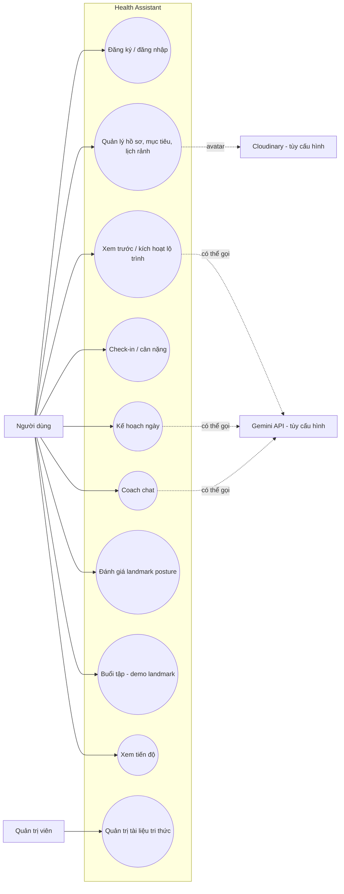
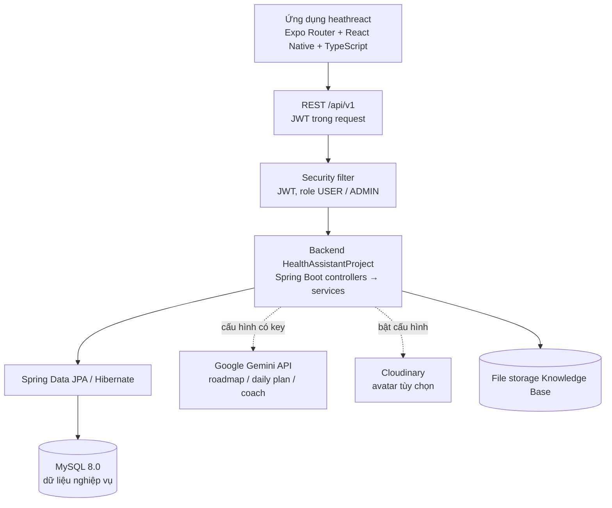
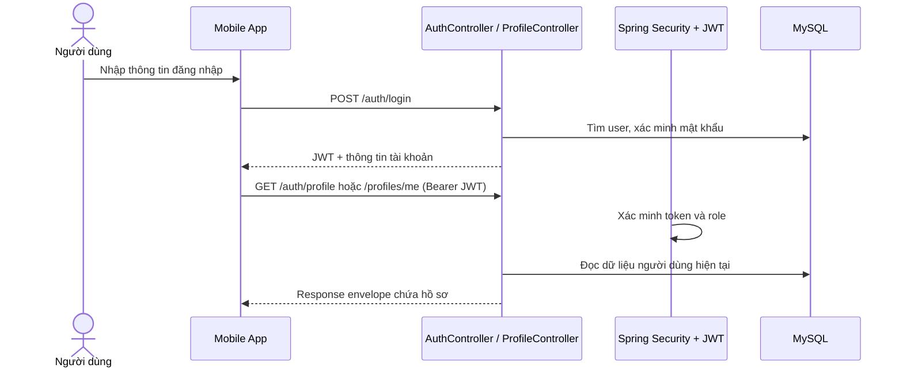
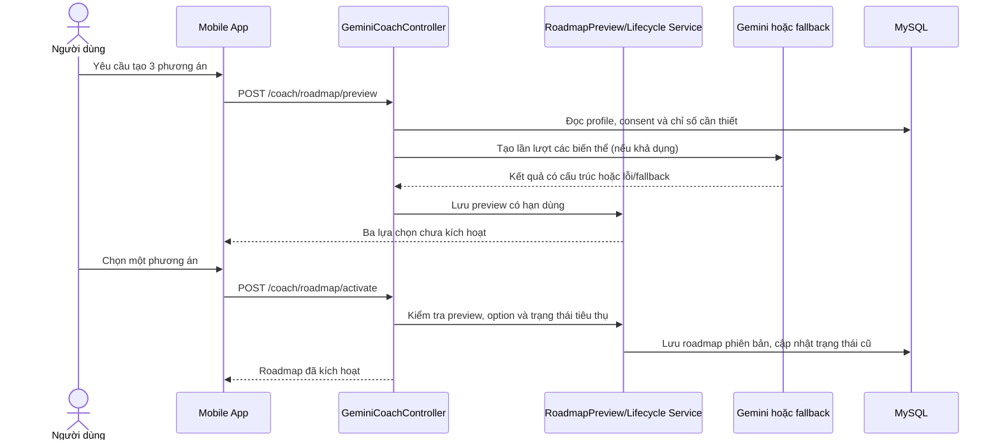
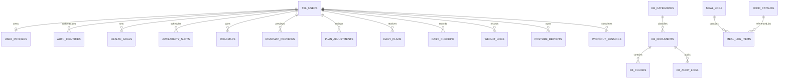

<div align="center">

**[CẦN BỔ SUNG: TÊN TRƯỜNG]**  
**[CẦN BỔ SUNG: TÊN KHOA]**

---

**[CẦN BỔ SUNG: TÊN HỌC PHẦN]**  
**[CẦN BỔ SUNG: LOẠI BÁO CÁO]**

# BÁO CÁO ĐỒ ÁN

## HỆ THỐNG HEALTH ASSISTANT

### Xây dựng hệ thống AI cá nhân hóa lộ trình dinh dưỡng và tập luyện thể chất

| Sinh viên thực hiện | MSSV | Lớp | Vai trò |
|---|---|---|---|
| [CẦN BỔ SUNG: Họ tên] | [CẦN BỔ SUNG: MSSV] | [CẦN BỔ SUNG: Lớp] | [CẦN BỔ SUNG: Vai trò] |
| [CẦN BỔ SUNG: Họ tên thành viên nếu có] | [CẦN BỔ SUNG: MSSV] | [CẦN BỔ SUNG: Lớp] | [CẦN BỔ SUNG: Vai trò] |

**Giảng viên hướng dẫn:** [CẦN BỔ SUNG: Họ tên giảng viên]  
**Học kỳ / năm học:** [CẦN BỔ SUNG: Học kỳ / năm học]  
**Địa điểm:** [CẦN BỔ SUNG: Địa điểm]  
**Năm:** 2026

</div>

---

## LỜI CẢM ƠN

Nhóm thực hiện xin trân trọng cảm ơn giảng viên hướng dẫn đã định hướng chuyên môn và góp ý trong quá trình xây dựng đề tài. Nhóm cũng cảm ơn các thầy cô và những người đã cung cấp kiến thức, tài liệu và điều kiện để nhóm khảo sát, phát triển và hoàn thiện sản phẩm. Những thiếu sót trong báo cáo và hệ thống là trách nhiệm của nhóm; nhóm mong nhận được ý kiến đóng góp để tiếp tục cải thiện.

## MỤC LỤC

- [Danh mục hình ảnh](#danh-mục-hình-ảnh)
- [Danh mục bảng](#danh-mục-bảng)
- [Danh mục từ viết tắt](#danh-mục-từ-viết-tắt)
- [Chương 1. Tổng quan đề tài](#chương-1-tổng-quan-đề-tài)
- [Chương 2. Cơ sở lý thuyết và công nghệ sử dụng](#chương-2-cơ-sở-lý-thuyết-và-công-nghệ-sử-dụng)
- [Chương 3. Phân tích và thiết kế hệ thống](#chương-3-phân-tích-và-thiết-kế-hệ-thống)
- [Chương 4. Cài đặt và triển khai](#chương-4-cài-đặt-và-triển-khai)
- [Chương 5. Kiểm thử](#chương-5-kiểm-thử)
- [Chương 6. Kết luận và hướng phát triển](#chương-6-kết-luận-và-hướng-phát-triển)
- [Tài liệu tham khảo](#tài-liệu-tham-khảo)
- [Phụ lục](#phụ-lục)

## DANH MỤC HÌNH ẢNH

| Mã hình | Tên hình |
|---|---|
| Hình 3.1 | Sơ đồ tác nhân và nhóm chức năng (use case mức tổng quát) |
| Hình 3.2 | Kiến trúc tổng thể được suy ra từ mã nguồn |
| Hình 3.3 | Luồng xác thực và tải hồ sơ |
| Hình 3.4 | Luồng xem trước và kích hoạt lộ trình |
| Hình 3.5 | Mô hình dữ liệu (ERD mức khái niệm) |

Ghi chú: các hình trên là sơ đồ Mermaid nhúng trong báo cáo, không phải ảnh chụp giao diện. Không có ảnh chụp ứng dụng được đưa vào vì phiên kiểm tra không khởi chạy được ứng dụng (thiếu JDK và dependency mobile chưa resolve). Không sử dụng ảnh giả lập để thay cho kết quả chạy thật.

## DANH MỤC BẢNG

| Mã bảng | Tên bảng |
|---|---|
| Bảng 2.1 | Tổng hợp công nghệ và phiên bản |
| Bảng 3.1 | Yêu cầu chức năng |
| Bảng 3.2 | Yêu cầu phi chức năng |
| Bảng 3.3 | Danh sách endpoint API |
| Bảng 3.4–3.24 | Từ điển dữ liệu theo entity/bảng |
| Bảng 3.25 | Màn hình ứng dụng |
| Bảng 5.1 | Kết quả kiểm tra tự động trong workspace |
| Bảng 5.2 | Test case chức năng |
| Bảng PL.1 | Phân công công việc |

## DANH MỤC TỪ VIẾT TẮT

| Viết tắt | Tiếng Anh | Ý nghĩa |
|---|---|---|
| API | Application Programming Interface | Giao diện lập trình ứng dụng |
| AI | Artificial Intelligence | Trí tuệ nhân tạo |
| DB | Database | Cơ sở dữ liệu |
| ERD | Entity-Relationship Diagram | Sơ đồ thực thể – liên kết |
| HTTP | Hypertext Transfer Protocol | Giao thức truyền tải siêu văn bản |
| JWT | JSON Web Token | Token xác thực dạng JSON |
| LLM | Large Language Model | Mô hình ngôn ngữ lớn |
| ORM | Object-Relational Mapping | Ánh xạ đối tượng – quan hệ |
| REST | Representational State Transfer | Kiểu kiến trúc dịch vụ web |
| UI | User Interface | Giao diện người dùng |
| DTO | Data Transfer Object | Đối tượng truyền dữ liệu |
| CRUD | Create, Read, Update, Delete | Tạo, đọc, cập nhật, xóa dữ liệu |
| RAG | Retrieval-Augmented Generation | Sinh nội dung có tăng cường truy xuất |

# CHƯƠNG 1. TỔNG QUAN ĐỀ TÀI

## 1.1. Lý do chọn đề tài

Việc duy trì thói quen vận động và theo dõi các chỉ số thể chất đòi hỏi người dùng ghi nhận dữ liệu đều đặn, đặt mục tiêu phù hợp và đánh giá tiến độ theo thời gian. Health Assistant được định hướng như một ứng dụng hỗ trợ tập trung những thao tác đó trong một trải nghiệm di động, kết hợp hồ sơ sức khỏe do người dùng cung cấp, nhật ký hằng ngày, lộ trình tập luyện và trợ lý hội thoại.

Phần mô tả nghiệp vụ trong `DO_AN.md` đặt mục tiêu dùng AI để cá nhân hóa lộ trình. Mã nguồn hiện thực một phần mục tiêu này: backend có các dịch vụ gọi Gemini với kiểm tra cấu trúc đầu ra và fallback; người dùng có thể tạo preview ba lựa chọn lộ trình, chọn và kích hoạt một lựa chọn. Tuy nhiên, ứng dụng chưa phải hệ thống tư vấn y tế, và các nghiệp vụ dinh dưỡng, nhận diện camera thật cùng truy xuất RAG cho chat chưa hoàn chỉnh. Báo cáo giới hạn các nhận định theo phạm vi mã hiện có.

## 1.2. Mục tiêu

- Xây dựng ứng dụng di động đa nền tảng với các màn hình hồ sơ, lộ trình, kế hoạch ngày, check-in và tiến độ.
- Xây dựng REST API xác thực bằng JWT, phân quyền người dùng/quản trị viên và lưu dữ liệu sức khỏe cơ bản.
- Hỗ trợ xem trước, xác nhận, lưu lịch sử lộ trình; đề xuất điều chỉnh có bước người dùng chấp nhận hoặc từ chối.
- Tích hợp Gemini cho một số luồng tạo lộ trình, kế hoạch ngày và phản hồi coach; kiểm tra cấu trúc và có nhánh fallback.
- Quản lý tài liệu Knowledge Base bằng giao diện admin, gồm tải lên, xem xét, lưu trữ và audit.
- Giữ giới hạn an toàn: không tuyên bố chẩn đoán; dữ liệu pose thiếu độ tin cậy không được trình bày như phép đo tin cậy; nội dung demo phải được phân biệt với dữ liệu thực.

## 1.3. Đối tượng và phạm vi

**Đối tượng sử dụng** gồm người dùng cuối, quản trị viên Knowledge Base và thành phần AI chạy bên trong backend. AI Assistant không phải tài khoản độc lập. Người dùng quản lý hồ sơ, mục tiêu, lịch rảnh, lộ trình, nhật ký và tiến độ; admin quản trị tài liệu tri thức.

**Phạm vi đã có trong mã nguồn:** đăng ký/đăng nhập, đăng nhập Google ở backend, hồ sơ và consent, mục tiêu sức khỏe, khung giờ rảnh, cân nặng, check-in hằng ngày, tóm tắt tiến độ, đánh giá posture dựa trên landmark đầu vào, lộ trình (preview/activate/history), kế hoạch ngày, coach chat, workout engine ở mức nhận dữ liệu landmark, upload avatar Cloudinary tùy cấu hình và quản trị tài liệu Knowledge Base.

**Giới hạn được xác nhận:** ứng dụng chưa kết nối camera pose pipeline thật; màn hình workout gửi giá trị landmark mẫu. Màn hình dinh dưỡng hiện chỉ hiển thị trạng thái trống; các entity thực phẩm và nhật ký bữa ăn chưa có API/service người dùng tương ứng. Check-in, cân nặng, roadmap và daily plan có dữ liệu/backend nhưng vẫn cần kiểm thử end-to-end. Coach chat chưa lưu lịch sử hội thoại và chưa truy xuất chunk Knowledge Base/RAG. Daily plan fallback là nội dung mẫu chung, không phải kế hoạch cá nhân hóa. Thông báo, push notification và gamification chưa được triển khai.

Hệ thống là công cụ hỗ trợ theo dõi thói quen, không thay thế bác sĩ, chuyên gia dinh dưỡng hoặc huấn luyện viên. Các chỉ số posture là ước lượng theo landmark và ngưỡng quy tắc, không phải kết luận y khoa.

## 1.4. Phương pháp thực hiện

Nhóm khảo sát tài liệu nghiệp vụ `DO_AN.md`, tiến độ `TIEN_DO.md`, cấu hình build và cấu hình môi trường mẫu; đọc controller, service, entity, repository và màn hình mobile để phân biệt thiết kế với chức năng thực thi. Kiến trúc backend chia module theo miền nghiệp vụ; mobile dùng Expo Router theo route file. CSDL dùng entity JPA và thiết lập Hibernate `ddl-auto: update`, kết hợp SQL khởi tạo MySQL. Kiểm thử được xem xét từ các lớp test JUnit hiện có và các lệnh lint/type-check chạy được trong môi trường kiểm tra.

## 1.5. Bố cục báo cáo

Chương 1 giới thiệu đề tài và phạm vi; Chương 2 nêu cơ sở và công nghệ tìm thấy trong cấu hình; Chương 3 mô tả yêu cầu, kiến trúc, luồng, dữ liệu, API và giao diện; Chương 4 trình bày cấu trúc, môi trường và cách cài đặt; Chương 5 ghi nhận kết quả kiểm thử thực tế; Chương 6 kết luận, nêu hạn chế và hướng tiếp tục.

# CHƯƠNG 2. CƠ SỞ LÝ THUYẾT VÀ CÔNG NGHỆ SỬ DỤNG

## 2.1. Mô hình ứng dụng client–server và REST

Ứng dụng mobile gửi request HTTP tới backend theo tiền tố `/api/v1`. Backend nhận request qua controller, kiểm tra dữ liệu và quyền, gọi service xử lý nghiệp vụ rồi trả DTO trong response envelope. Mô hình này tách giao diện khỏi quy tắc nghiệp vụ và cho phép backend giữ thông tin xác thực Gemini/Cloudinary thay vì đặt bí mật trong ứng dụng.

## 2.2. Xác thực JWT và phân quyền

JSON Web Token được phát hành sau xác thực, ứng dụng gửi token để backend xác định người dùng ở các request tiếp theo. Backend có `JwtAuthenticationFilter`, cấu hình session stateless, BCrypt password encoder và phân quyền đường dẫn. Nhóm `/api/v1/admin/knowledge/**` yêu cầu role admin; các API `/api/v1/**` còn lại yêu cầu role user, ngoài whitelist xác thực/tài liệu. Đăng nhập Google xác minh ID token ở backend nếu cấu hình client ID hợp lệ. Đây là cơ chế kiểm soát truy cập; việc cấu hình production như secret, HTTPS, CORS và giới hạn request vẫn cần hoàn thiện.

## 2.3. Tầng lưu trữ quan hệ và ORM

MySQL là hệ quản trị dữ liệu quan hệ. Entity dùng Jakarta Persistence/Hibernate để ánh xạ dữ liệu và Spring Data repository thực hiện truy vấn ở nhiều module; `UserMapper`/MyBatis được dùng trong luồng tài khoản. Cấu hình local dùng Hibernate `ddl-auto: update`; các script SQL trong `db/init` khởi tạo schema và một số dữ liệu. Không thấy Flyway/Liquibase hoặc thư mục migration version hóa.

## 2.4. Gọi mô hình ngôn ngữ qua backend

`GeminiClient` là client tích hợp Gemini dùng WebClient; các service roadmap, daily plan và coach xây dựng request, ánh xạ kết quả và kiểm tra schema/ràng buộc. Một số luồng có fallback để API vẫn có thể trả kết quả nếu thiếu khóa hoặc model gặp lỗi; do đó không được mặc định mọi kết quả trong môi trường chạy đều được sinh bởi AI. Chưa có bằng chứng trong code về pipeline embedding/vector database/RAG hoàn chỉnh. Knowledge Base hiện có xử lý upload, trích xuất và chunk văn bản để quản trị; việc dùng các chunk đó làm ngữ cảnh trả lời coach chưa được triển khai/kiểm chứng.

## 2.5. Ứng dụng đa nền tảng

React Native cung cấp thành phần giao diện dùng chung cho mobile; Expo bổ sung quy trình chạy và các module native; Expo Router ánh xạ file trong `app/` thành route. TypeScript định nghĩa kiểu dữ liệu UI/API. Zustand lưu trạng thái client như phiên người dùng; TanStack Query quản lý truy vấn/cache trong các màn hình dùng query; React Hook Form và Zod hỗ trợ một số biểu mẫu. API client ở `src/api/client.ts` dùng `fetch`, dù package còn khai báo Axios ở phần dependency.

## 2.6. Bảng tổng hợp công nghệ

Phiên bản dưới đây lấy từ `build.gradle`, `gradle-wrapper.properties`, `package.json`, `.nvmrc`, Docker Compose và các file cấu hình trong workspace; dấu `^` hoặc `~` giữ nguyên phạm vi phiên bản khai báo, không khẳng định phiên bản đã cài trong môi trường kiểm tra.

| Công nghệ | Phiên bản khai báo | Vai trò |
|---|---|---|
| Java | 17 (sourceCompatibility) | Ngôn ngữ backend |
| Spring Boot | 3.2.3 | Khởi tạo ứng dụng và REST backend |
| Gradle Wrapper | 8.8 | Build và chạy test backend |
| Spring Data JPA | theo Spring Boot dependency management | ORM và repository dữ liệu |
| MyBatis Spring Boot Starter | 3.0.3 | Dependency truy cập dữ liệu; chưa thấy mapper được dùng trong luồng chức năng chính |
| MySQL | Docker image 8.0 | CSDL quan hệ |
| JJWT | 0.11.5 | Tạo/xác minh JWT |
| Springdoc OpenAPI | 2.3.0 | Tài liệu API/Swagger |
| Cloudinary Java SDK | 2.5.0 | Upload avatar nếu bật và có cấu hình |
| Apache Tika | 3.2.3 | Trích xuất nội dung tài liệu Knowledge Base |
| Expo | ~57.0.30 (SDK) | Nền tảng ứng dụng React Native |
| React Native | 0.86.3 | Giao diện đa nền tảng |
| React | 19.2.3 | Thư viện UI |
| TypeScript | ~6.0.3 | Kiểm tra kiểu phía mobile |
| Expo Router | ~57.0.28 | Điều hướng theo file |
| Zustand | ^5.0.12 | Quản lý trạng thái client |
| TanStack Query | ^5.104.4 | Cache/trạng thái truy vấn API |
| React Hook Form | ^7.90.0 | Quản lý biểu mẫu |
| Zod | ^4.6.7 | Kiểm tra dữ liệu biểu mẫu |
| Node.js | 22.13.0 (`.nvmrc`) | Môi trường công cụ mobile |
| Docker Compose | khai báo trong `docker-compose.yml` | Chạy MySQL và backend theo cấu hình dự án |
| Google Gemini API | model mặc định trong cấu hình: `gemini-3.8-flash` | Sinh nội dung roadmap/daily plan/chat khi cấu hình khóa hợp lệ |

# CHƯƠNG 3. PHÂN TÍCH VÀ THIẾT KẾ HỆ THỐNG

## 3.1. Yêu cầu chức năng

| Mã | Yêu cầu | Trạng thái theo mã nguồn |
|---|---|---|
| FR01 | Đăng ký, đăng nhập bằng tài khoản; cấp JWT | Có API signup/login |
| FR02 | Đăng nhập Google và liên kết identity | Có backend; phụ thuộc cấu hình Google OAuth |
| FR03 | Xem hồ sơ tài khoản và cập nhật hồ sơ sức khỏe/consent | Có API và màn hình hồ sơ |
| FR04 | Cập nhật avatar | Có API Cloudinary tùy chọn; giới hạn ảnh JPEG/PNG 5 MB trong service |
| FR05 | Khai báo mục tiêu sức khỏe và lịch rảnh | Có API, entity và giao diện hồ sơ |
| FR06 | Xem trước ba hướng lộ trình, chọn và kích hoạt | Có API preview/activate và UI Roadmap |
| FR07 | Xem roadmap hiện hành, lịch sử và chi tiết | Có API và màn hình roadmap |
| FR08 | Đề xuất điều chỉnh và chờ người dùng quyết định | Có API evaluate/accept/reject và hiển thị trong Roadmap |
| FR09 | Tạo và xem kế hoạch trong ngày | Có API; có nhánh Gemini và fallback |
| FR10 | Ghi check-in hằng ngày, xem lịch sử/tóm tắt, xóa | Có API và UI |
| FR11 | Ghi, xem, xóa lịch sử cân nặng | Có API và UI tiến độ |
| FR12 | Xem tổng quan tiến độ | Có API summary; hiện chủ yếu tổng hợp số bản ghi, chưa phải phân tích tuân thủ toàn diện |
| FR13 | Gửi landmark để đánh giá tư thế và lưu báo cáo | Có API/service; đầu vào là landmark, chưa xác nhận camera thật trên mobile |
| FR14 | Theo dõi phase/repetition buổi tập và lưu buổi tập | Có engine API; UI hiện sử dụng landmark mẫu/demo |
| FR15 | Gửi câu hỏi cho coach | Có API chat; chưa lưu lịch sử hội thoại và chưa có RAG/citations được xác nhận |
| FR16 | Quản trị tài liệu tri thức: tải lên, xem, duyệt, tải file, audit, archive | Có API admin và màn hình riêng |
| FR17 | Tìm thực phẩm và ghi nhật ký bữa ăn | Chưa có luồng người dùng/API tương ứng; UI hiện trạng thái rỗng |
| FR18 | Thông báo, push, gamification | Chưa triển khai |

## 3.2. Yêu cầu phi chức năng

| Nhóm | Yêu cầu/đặc điểm quan sát được |
|---|---|
| Bảo mật | API dùng JWT stateless; BCrypt cho mật khẩu; tách quyền admin Knowledge Base; khóa AI được dự định cấu hình ở backend. Cần thay secret mặc định/cấu hình phát triển trước triển khai thật. |
| An toàn nội dung | Coach có nhánh xử lý nội dung liên quan đau; dịch vụ posture đánh dấu độ tin cậy theo visibility tối thiểu 0,5; không coi kết quả là chẩn đoán. |
| Tính sẵn sàng | Một số dịch vụ AI có fallback khi thiếu key/lỗi; fallback không tương đương đầu ra cá nhân hóa từ model. |
| Tính toàn vẹn | Có unique constraint cho một số dữ liệu như profile theo user, daily plan theo ngày và check-in theo ngày; quyền sở hữu được kiểm tra ở service của các tài nguyên người dùng. |
| Khả năng bảo trì | Backend chia module theo miền; mobile chia route, feature, service và component. Có test đơn vị một số service, nhưng kiểm thử tích hợp/E2E còn thiếu. |
| Khả năng triển khai | Có Dockerfile, Docker Compose và Gradle Wrapper; cấu hình production checklist trong README chưa hoàn tất (HTTPS, secret, CORS, rate limit, giám sát). |
| Quyền riêng tư | App không gọi Gemini trực tiếp. Theo README, avatar chỉ để hiển thị; workout/scan hiện gửi landmark mẫu thay vì video camera. Cần đánh giá consent/lưu trữ dữ liệu trước khi triển khai thực tế. |

## 3.3. Tác nhân và sơ đồ use case

Tác nhân trực tiếp là Người dùng và Quản trị viên. AI Assistant là dịch vụ nội bộ được backend gọi, không đăng nhập như tác nhân người dùng. Sơ đồ sau tóm tắt các chức năng đã thấy trong ứng dụng; khung nét đứt thể hiện tích hợp AI/Cloudinary là tùy cấu hình hoặc có fallback.



**Hình 3.1.** Tác nhân và nhóm chức năng. Một số chức năng đặt trong tài liệu nghiệp vụ nhưng chưa có luồng thực tế, như nhật ký dinh dưỡng, không được biểu diễn như use case đã hoàn tất.

## 3.4. Kiến trúc tổng thể



**Hình 3.2.** Kiến trúc logic. Mã nguồn cấu hình Gemini và Cloudinary qua backend. Knowledge Base dùng lưu file và lưu metadata/chunk trong các bảng; không có vector database được cấu hình trong project này.

Luồng backend theo cấu trúc controller → service → repository/entity. Ngoại lệ được chuẩn hóa bằng `GlobalExceptionHandler` và response envelope `DefaultRes`. Mobile tách API client/service khỏi page; route file trong `app/` nạp page ở `src/features/`. Xác thực dùng JWT; route mobile cũng có layout theo nhóm user/admin.

## 3.5. Luồng xử lý chính

### 3.5.1. Đăng nhập và lấy hồ sơ



**Hình 3.3.** Luồng xác thực và đọc hồ sơ. Các endpoint đăng nhập nằm trong whitelist; API nghiệp vụ yêu cầu token.

### 3.5.2. Xem trước và kích hoạt roadmap



**Hình 3.4.** Luồng preview/activate. Backend yêu cầu hồ sơ, consent, chiều cao và cân nặng trước khi preview. Việc gọi Gemini có thể chuyển sang fallback.

### 3.5.3. Check-in hằng ngày

Người dùng nhập check-in tại màn hình tương ứng; mobile gửi `PUT /api/v1/daily-checkins/me/{date}`. Backend xác thực người dùng, kiểm tra request, tạo hoặc cập nhật bản ghi theo cặp người dùng/ngày rồi trả DTO. Các endpoint GET đọc ngày, khoảng thời gian hoặc summary; DELETE xóa check-in ngày đã chọn. Check-in có thể đồng bộ cân nặng theo quy tắc của service, nhưng lịch sử ngày cũ không được xem là cập nhật cân nặng hiện tại trong hồ sơ.

## 3.6. Thiết kế cơ sở dữ liệu

Sơ đồ dưới đây mô tả quan hệ logic suy ra từ các entity. Nhiều cột `user_id` chỉ là khóa liên kết logic kiểu số, không khai báo `@ManyToOne`/khóa ngoại tới `tbl_users`; quan hệ nối bằng nét chấm cần được xem là quan hệ nghiệp vụ, không khẳng định là FK vật lý. Entity KnowledgeChunk có quan hệ JPA bắt buộc tới KnowledgeDocument.



**Hình 3.5.** ERD khái niệm từ entity hiện có. Bản vẽ ERD chi tiết trong workspace có thể khác với schema khởi tạo ban đầu; Hibernate `update` bổ sung/cập nhật bảng khi ứng dụng khởi động.

Kiểu dưới đây là kiểu logic dựa trên Java/JPA; kiểu vật lý cuối cùng do Hibernate/MySQL tạo ra và có thể chịu ảnh hưởng annotation/cấu hình. `PK` là khóa chính; `NN` là không null; `UQ` là duy nhất; `FK` chỉ ghi ở quan hệ được entity khai báo rõ.

### Bảng 3.4. `tbl_users` – tài khoản

| Tên trường | Kiểu dữ liệu | Ràng buộc | Mô tả |
|---|---|---|---|
| user_id | BIGINT | PK, tự tăng | Mã tài khoản |
| username | VARCHAR(254) | NN, UQ | Tên đăng nhập |
| password | VARCHAR | Có thể null theo entity | Mật khẩu đã mã hóa; tài khoản OAuth có thể không dùng mật khẩu |
| email | VARCHAR(254) | Có thể null | Email |
| display_name | VARCHAR(120) | Có thể null | Tên hiển thị |
| enable | BOOLEAN | Có thể null | Trạng thái kích hoạt |
| is_deleted | BOOLEAN | Có thể null | Cờ xóa mềm |
| role | VARCHAR/enum | NN | Vai trò USER/ADMIN |
| created_at, created_id, updated_at, updated_id | thời gian / chuỗi | Kế thừa BaseEntity | Thông tin kiểm toán |

### Bảng 3.5. `auth_identities` – định danh đăng nhập ngoài

| Tên trường | Kiểu dữ liệu | Ràng buộc | Mô tả |
|---|---|---|---|
| id | BIGINT | PK, tự tăng | Mã identity |
| user_id | BIGINT | NN, liên kết logic | Tài khoản nội bộ |
| provider | VARCHAR(30) | NN; UQ cùng provider_subject và user_id | Nhà cung cấp xác thực |
| provider_subject | VARCHAR(255) | NN | Mã chủ thể từ provider |
| provider_email | VARCHAR(254) | NN | Email provider trả về |
| email_verified | BOOLEAN | NN | Trạng thái xác minh email |
| created_at, last_login_at | Instant | NN | Thời điểm tạo và đăng nhập cuối |

### Bảng 3.6. `user_profiles` – hồ sơ

| Tên trường | Kiểu dữ liệu | Ràng buộc | Mô tả |
|---|---|---|---|
| id | BIGINT | PK, tự tăng | Mã hồ sơ |
| user_id | BIGINT | NN, UQ | Mỗi tài khoản tối đa một hồ sơ |
| goal, activity_level | VARCHAR(40) | NN | Mục tiêu và mức vận động |
| gender | VARCHAR(10) | Có thể null | Giới tính khai báo |
| age | INT | Có thể null | Tuổi |
| height_cm, weight_kg | DOUBLE | Có thể null | Chiều cao, cân nặng hiện tại |
| restrictions, pain_areas | VARCHAR(1000) | Có thể null | Hạn chế và vùng đau do người dùng nhập |
| avatar_url | VARCHAR(1000) | Có thể null | URL avatar |
| avatar_public_id | VARCHAR(255) | Có thể null | Mã ảnh trên Cloudinary |
| consent | BOOLEAN | NN | Đồng ý xử lý dữ liệu hồ sơ |
| updated_at | Instant | NN | Thời điểm cập nhật |

### Bảng 3.7. `health_goals` – mục tiêu sức khỏe

| Tên trường | Kiểu dữ liệu | Ràng buộc | Mô tả |
|---|---|---|---|
| id | BIGINT | PK | Mã mục tiêu |
| user_id | BIGINT | NN, liên kết logic; index với status | Chủ sở hữu |
| goal_type | VARCHAR(30) | NN | Loại mục tiêu |
| start_weight_kg, target_weight_kg | DECIMAL(5,2) | Có thể null | Cân nặng bắt đầu/mục tiêu |
| start_date, target_date | DATE | Ngày mục tiêu cần có theo request | Mốc thời gian |
| status | VARCHAR(20) | Mặc định ACTIVE | Trạng thái |
| notes | VARCHAR/TEXT | Có thể null | Ghi chú |
| created_at, updated_at | Instant | Tự gán | Thời điểm tạo/cập nhật |

### Bảng 3.8. `availability_slots` – khung giờ rảnh

| Tên trường | Kiểu dữ liệu | Ràng buộc | Mô tả |
|---|---|---|---|
| id | BIGINT | PK | Mã khung giờ |
| user_id | BIGINT | NN, liên kết logic | Chủ sở hữu |
| day_of_week | INT | NN | Ngày trong tuần |
| start_time, end_time | TIME | NN | Khoảng giờ |
| activity_type, location_type | VARCHAR | Có thể null | Loại hoạt động/địa điểm |
| equipment_notes | VARCHAR/TEXT | Có thể null | Ghi chú dụng cụ |
| active | BOOLEAN | Mặc định true | Còn hiệu lực hay không |
| created_at | Instant | Theo entity | Thời điểm tạo |

### Bảng 3.9. `roadmaps` – lộ trình đã lưu

| Tên trường | Kiểu dữ liệu | Ràng buộc | Mô tả |
|---|---|---|---|
| id | BIGINT | PK | Mã roadmap |
| user_id | BIGINT | NN, liên kết logic | Chủ sở hữu |
| title | VARCHAR(160) | NN | Tiêu đề |
| overview | TEXT | Có thể null | Tổng quan |
| weekly_plan | MEDIUMTEXT | Có thể null | Nội dung kế hoạch tuần |
| safety_notes | TEXT | Có thể null | Lưu ý an toàn |
| source, status | VARCHAR(30/20) | source NN; status mặc định ACTIVE | Nguồn tạo và trạng thái |
| start_date | DATE | Có thể null | Ngày bắt đầu |
| duration_weeks | INT | Có thể null | Thời lượng tuần |
| version_number | INT | Có thể null với bản cũ | Phiên bản |
| previous_roadmap_id | BIGINT | Có thể null, liên kết logic | Phiên bản trước |
| change_reason | VARCHAR(500) | Có thể null | Lý do đổi |
| prompt_version, schema_version | VARCHAR(40) | Có thể null | Phiên bản prompt/schema |
| created_at | Instant | NN | Thời điểm tạo |

### Bảng 3.10. `roadmap_previews` – bản preview tạm

| Tên trường | Kiểu dữ liệu | Ràng buộc | Mô tả |
|---|---|---|---|
| id | VARCHAR(36) | PK | Mã preview |
| user_id | BIGINT | NN, liên kết logic | Chủ sở hữu |
| profile_updated_at | Instant | NN | Phiên bản hồ sơ khi tạo preview |
| options_json | LOB/TEXT | NN | Danh sách phương án JSON |
| expires_at | Instant | NN | Thời điểm hết hạn |
| consumed_at | Instant | Có thể null | Thời điểm preview được sử dụng |

### Bảng 3.11. `plan_adjustments` – đề xuất điều chỉnh

| Tên trường | Kiểu dữ liệu | Ràng buộc | Mô tả |
|---|---|---|---|
| id | BIGINT | PK | Mã đề xuất |
| user_id | BIGINT | NN, liên kết logic | Chủ sở hữu |
| roadmap_id | BIGINT | Có thể null, liên kết logic | Roadmap liên quan |
| trigger_type | VARCHAR(40) | NN | Loại tín hiệu kích hoạt |
| reason | VARCHAR(1000) | NN | Giải thích |
| proposed_changes | JSON | NN | Thay đổi được đề xuất |
| status | VARCHAR(20) | NN, mặc định PROPOSED | Trạng thái quyết định |
| created_at | Instant | NN | Thời điểm tạo |
| decided_at | Instant | Có thể null | Thời điểm chấp nhận/từ chối |

### Bảng 3.12. `daily_plans` – kế hoạch trong ngày

| Tên trường | Kiểu dữ liệu | Ràng buộc | Mô tả |
|---|---|---|---|
| id | BIGINT | PK | Mã kế hoạch |
| user_id | BIGINT | NN, liên kết logic | Chủ sở hữu |
| plan_date | DATE | NN; unique cùng user_id | Ngày áp dụng |
| title | VARCHAR(160) | NN | Tiêu đề |
| duration | VARCHAR(40) | NN | Thời lượng dạng chuỗi |
| activities | TEXT | NN | Nội dung hoạt động, lưu dạng chuỗi/JSON |
| safety_notes | TEXT | NN | Lưu ý an toàn |
| source | VARCHAR(40) | NN | Nguồn AI/fallback |
| created_at | Instant | NN | Thời điểm tạo |

### Bảng 3.13. `daily_checkins` – nhật ký check-in

| Tên trường | Kiểu dữ liệu | Ràng buộc | Mô tả |
|---|---|---|---|
| id | BIGINT | PK | Mã check-in |
| user_id | BIGINT | NN; unique với check_in_date | Chủ sở hữu |
| check_in_date | DATE | NN | Ngày ghi nhận |
| weight_kg | DECIMAL(5,2) | Có thể null | Cân nặng nhập trong check-in |
| energy_level, sleep_quality, fatigue_level | INT | Có thể null; validation tại request | Mức năng lượng/chất lượng ngủ/mệt mỏi |
| sleep_hours | DECIMAL(4,2) | Có thể null | Số giờ ngủ |
| mood | VARCHAR(20) | Có thể null | Tâm trạng |
| activity_notes | VARCHAR(500) | Có thể null | Hoạt động |
| note | VARCHAR(1000) | Có thể null | Ghi chú |
| created_at, updated_at | Instant | NN | Thời điểm tạo/cập nhật |

### Bảng 3.14. `weight_logs` – lịch sử cân nặng

| Tên trường | Kiểu dữ liệu | Ràng buộc | Mô tả |
|---|---|---|---|
| id | BIGINT | PK | Mã số đo |
| user_id | BIGINT | NN; unique với measured_on | Chủ sở hữu |
| measured_on | DATE | NN | Ngày đo |
| weight_kg | DECIMAL(5,2) | NN | Số cân |
| note | VARCHAR(500) | Có thể null | Ghi chú |
| created_at | Instant | NN | Thời điểm ghi |

### Bảng 3.15. `posture_reports` – kết quả posture

| Tên trường | Kiểu dữ liệu | Ràng buộc | Mô tả |
|---|---|---|---|
| id | BIGINT | PK | Mã báo cáo |
| user_id | BIGINT | NN, liên kết logic | Chủ sở hữu |
| view | VARCHAR(10) | NN | Hướng nhìn được gửi lên |
| reliable | BOOLEAN | NN | Kết quả qua visibility gate |
| shoulder_imbalance_degrees, pelvic_tilt_degrees, forward_head_degrees | DOUBLE | NN | Các góc ước lượng |
| findings, recommendations | chuỗi JSON/TEXT | Có thể null | Nhận xét và gợi ý |
| created_at | Instant | NN | Thời điểm đánh giá |

### Bảng 3.16. `workout_sessions` – buổi tập đã lưu

| Tên trường | Kiểu dữ liệu | Ràng buộc | Mô tả |
|---|---|---|---|
| id | BIGINT | PK | Mã buổi tập |
| user_id | BIGINT | NN, liên kết logic | Chủ sở hữu |
| exercise | VARCHAR(40) | NN | Mã/tên bài tập |
| reps | INT | NN | Số lần lặp |
| completed_at | Instant | NN | Thời điểm kết thúc |

### Bảng 3.17. `exercise_catalog` – danh mục bài tập

| Tên trường | Kiểu dữ liệu | Ràng buộc | Mô tả |
|---|---|---|---|
| id | BIGINT | PK | Mã bài tập |
| code | VARCHAR | NN/UQ theo entity | Mã định danh |
| name | VARCHAR | NN | Tên bài |
| muscle_group, difficulty, equipment | VARCHAR | Theo entity | Nhóm cơ, độ khó, dụng cụ |
| instructions, safety_notes | TEXT/VARCHAR | Có thể null | Hướng dẫn và lưu ý |
| active | BOOLEAN | NN, mặc định true | Trạng thái |

### Bảng 3.18. `food_catalog` – danh mục thực phẩm (mới ở mức entity)

| Tên trường | Kiểu dữ liệu | Ràng buộc | Mô tả |
|---|---|---|---|
| id | BIGINT | PK | Mã thực phẩm |
| name | VARCHAR(180) | NN; có index tìm kiếm | Tên |
| serving_name | VARCHAR(100) | NN | Đơn vị khẩu phần |
| serving_grams, calories_kcal, protein_g, carbohydrates_g, fat_g | DECIMAL(8,2) | NN | Dữ liệu dinh dưỡng theo khẩu phần |
| source | VARCHAR(255) | Có thể null | Nguồn dữ liệu |
| is_active | BOOLEAN | NN, mặc định true | Trạng thái |

### Bảng 3.19. `meal_logs` – nhật ký bữa ăn (mới ở mức entity)

| Tên trường | Kiểu dữ liệu | Ràng buộc | Mô tả |
|---|---|---|---|
| id | BIGINT | PK | Mã bữa |
| user_id | BIGINT | NN, liên kết logic | Chủ sở hữu |
| logged_at | LocalDateTime | NN | Thời điểm ăn |
| meal_type | VARCHAR | Theo entity | Loại bữa |
| status | VARCHAR | Mặc định EATEN | Trạng thái |
| notes | VARCHAR/TEXT | Có thể null | Ghi chú |
| created_at | Instant | NN | Thời điểm tạo |

### Bảng 3.20. `meal_log_items` – thành phần bữa ăn (mới ở mức entity)

| Tên trường | Kiểu dữ liệu | Ràng buộc | Mô tả |
|---|---|---|---|
| id | BIGINT | PK | Mã dòng |
| meal_log_id | BIGINT | NN, liên kết logic | Bữa ăn |
| food_id | BIGINT | Có thể null, liên kết logic | Thực phẩm được chọn |
| food_name_snapshot | VARCHAR | NN theo entity | Tên chụp tại thời điểm ghi |
| quantity, serving_grams | DECIMAL | NN theo entity | Số lượng và khối lượng |
| calories_kcal, protein_g, carbohydrates_g, fat_g | DECIMAL | NN theo entity | Dinh dưỡng chụp tại thời điểm ghi |

### Bảng 3.21. `kb_categories` – nhóm tài liệu tri thức

| Tên trường | Kiểu dữ liệu | Ràng buộc | Mô tả |
|---|---|---|---|
| category_id | BIGINT | PK, tự tăng | Mã nhóm |
| code | VARCHAR(40) | NN, UQ | Mã nhóm |
| name | VARCHAR(120) | NN | Tên |
| active | BOOLEAN | NN, mặc định true | Trạng thái |
| sort_order | INT | NN | Thứ tự hiển thị |

### Bảng 3.22. `kb_documents` – tài liệu tri thức

| Tên trường | Kiểu dữ liệu | Ràng buộc | Mô tả |
|---|---|---|---|
| id | BIGINT | PK | Mã tài liệu |
| category_id | BIGINT | NN, quan hệ JPA tới category | Nhóm tài liệu |
| title | VARCHAR | NN | Tiêu đề |
| description, document_type | VARCHAR/TEXT | Theo entity | Mô tả và phân loại |
| source_organization, source_url, license_name | VARCHAR | Có thể null | Nguồn và giấy phép |
| rights_confirmed | BOOLEAN | NN | Người tải xác nhận quyền sử dụng |
| status | VARCHAR | Mặc định REVIEW | Trạng thái xét duyệt |
| original_filename, detected_mime, storage_key | VARCHAR | Theo entity | Metadata file |
| file_size_bytes | BIGINT | NN | Kích thước |
| file_sha256 | VARCHAR | Theo entity | Hash phát hiện trùng/integrity |
| extracted_text | TEXT/LONGTEXT | Theo entity | Văn bản trích xuất |
| chunk_count | INT | NN | Số đoạn được tạo |
| extraction_warning | TEXT | Có thể null | Cảnh báo trích xuất |
| created_by, reviewed_by | BIGINT | Có thể null, liên kết logic | Người thao tác |
| review_note | VARCHAR/TEXT | Có thể null | Ghi chú xét duyệt |
| created_at, updated_at, reviewed_at, deleted_at | LocalDateTime | Theo trạng thái | Mốc kiểm toán |
| row_version | BIGINT | Theo entity | Phiên bản optimistic locking |

### Bảng 3.23. `kb_chunks` – các đoạn tài liệu

| Tên trường | Kiểu dữ liệu | Ràng buộc | Mô tả |
|---|---|---|---|
| id | BIGINT | PK | Mã đoạn |
| document_id | BIGINT | NN, FK qua quan hệ `ManyToOne` | Tài liệu nguồn |
| chunk_index | INT | NN | Thứ tự đoạn |
| content | MEDIUMTEXT | NN | Nội dung đoạn văn bản |

### Bảng 3.24. `kb_audit_logs` – nhật ký quản trị tri thức

| Tên trường | Kiểu dữ liệu | Ràng buộc | Mô tả |
|---|---|---|---|
| audit_id | BIGINT | PK | Mã audit |
| document_id, actor_id | BIGINT | NN, liên kết logic | Tài liệu và người thao tác |
| action | VARCHAR(40) | NN | Thao tác |
| details | VARCHAR(1000) | Có thể null | Chi tiết |
| created_at | LocalDateTime | NN | Thời điểm |

## 3.7. Thiết kế API

API có tiền tố `/api/v1`. Trừ nhóm đăng nhập/đăng ký và tài liệu API public, request nghiệp vụ cần `Authorization: Bearer <JWT>`. Phân quyền theo cấu hình `SecurityConfig`: user vào API nghiệp vụ; admin vào `/admin/knowledge/**`; `/admin/**` khác bị từ chối trong cấu hình hiện tại. Controller trả `DefaultRes` trừ endpoint download file.

| Method | Endpoint | Mô tả | Quyền truy cập |
|---|---|---|---|
| POST | `/auth/login` | Đăng nhập bằng username/password, cấp JWT | Công khai |
| POST | `/auth/signup` | Đăng ký | Công khai |
| POST | `/auth/google` | Xác minh Google ID token và cấp JWT | Công khai; cần cấu hình OAuth |
| GET | `/auth/profile` | Lấy thông tin tài khoản trong token | Yêu cầu có user hiện tại trong service (dù route thuộc whitelist URL) |
| GET | `/user/users` | Endpoint kiểm tra user | USER |
| GET | `/admin/users` | Endpoint kiểm tra admin | Bị deny theo rule `/admin/**` hiện tại |
| POST | `/profiles` | Tạo/cập nhật hồ sơ | USER |
| GET | `/profiles/me` | Lấy hồ sơ hiện tại | USER |
| POST | `/profiles/me/avatar` | Upload avatar dạng multipart | USER; Cloudinary bật mới hoạt động |
| POST | `/health-goals` | Tạo mục tiêu | USER |
| GET | `/health-goals/me` | Liệt kê mục tiêu | USER |
| PATCH | `/health-goals/{id}/status` | Cập nhật trạng thái mục tiêu | USER, chủ sở hữu |
| POST | `/availability-slots` | Tạo khung giờ rảnh | USER |
| GET | `/availability-slots/me` | Liệt kê khung giờ | USER |
| DELETE | `/availability-slots/{id}` | Xóa khung giờ | USER, chủ sở hữu |
| POST | `/weight-logs` | Ghi số cân | USER |
| GET | `/weight-logs/me` | Liệt kê số cân; hỗ trợ from/to | USER |
| DELETE | `/weight-logs/{id}` | Xóa bản ghi cân nặng | USER, chủ sở hữu |
| PUT | `/daily-checkins/me/{date}` | Tạo/cập nhật check-in ngày | USER |
| GET | `/daily-checkins/me/{date}` | Lấy check-in theo ngày | USER |
| GET | `/daily-checkins/me` | Lịch sử check-in, hỗ trợ from/to | USER |
| GET | `/daily-checkins/summary?from=&to=` | Tổng hợp check-in trong khoảng | USER |
| DELETE | `/daily-checkins/me/{date}` | Xóa check-in theo ngày | USER |
| GET | `/progress/summary` | Tổng hợp tiến độ | USER |
| POST | `/posture/assess` | Đánh giá landmark posture | USER |
| GET | `/posture/reports/me` | Lịch sử báo cáo posture | USER |
| POST | `/coach/roadmap` | Tạo một roadmap (Gemini/fallback) | USER |
| POST | `/coach/roadmap/preview` | Tạo ba phương án chưa kích hoạt | USER, yêu cầu profile/consent/chiều cao/cân nặng |
| POST | `/coach/roadmap/activate` | Chọn và lưu phương án preview | USER |
| GET | `/coach/roadmaps/active` | Lấy roadmap hiện tại | USER |
| GET | `/coach/roadmaps/me` | Lịch sử roadmap | USER |
| GET | `/coach/roadmaps/{id}` | Chi tiết roadmap thuộc người dùng | USER, chủ sở hữu |
| POST | `/coach/chat` | Gửi câu hỏi cho coach | USER |
| POST | `/plan-adjustments/evaluate` | Đánh giá điều kiện đề xuất điều chỉnh | USER |
| GET | `/plan-adjustments/me` | Lịch sử đề xuất điều chỉnh | USER |
| POST | `/plan-adjustments/{id}/accept` | Chấp nhận đề xuất | USER, chủ sở hữu |
| POST | `/plan-adjustments/{id}/reject` | Từ chối đề xuất | USER, chủ sở hữu |
| GET | `/daily-plans/today` | Lấy kế hoạch hôm nay | USER |
| POST | `/daily-plans/today/generate` | Tạo kế hoạch ngày qua AI/fallback và lưu | USER |
| POST | `/workout-engine/track` | Nhận frame/landmark và trả phase, rep, feedback | USER |
| POST | `/workout-engine/end` | Kết thúc và lưu buổi tập | USER |
| POST | `/pose-engine/angle` | Tính góc giữa ba điểm | USER |
| GET | `/admin/knowledge/categories` | Danh sách danh mục KB | ADMIN |
| GET | `/admin/knowledge/stats` | Thống kê KB | ADMIN |
| GET | `/admin/knowledge?status=&q=` | Tìm/lọc tài liệu | ADMIN |
| POST | `/admin/knowledge` | Upload PDF/DOCX/TXT/MD và metadata | ADMIN |
| GET | `/admin/knowledge/{id}` | Chi tiết tài liệu | ADMIN |
| GET | `/admin/knowledge/{id}/audit` | Lịch sử thao tác | ADMIN |
| GET | `/admin/knowledge/{id}/file` | Tải file gốc | ADMIN |
| POST | `/admin/knowledge/{id}/review` | Duyệt/từ chối theo action | ADMIN |
| DELETE | `/admin/knowledge/{id}` | Archive tài liệu | ADMIN |

Các endpoint được liệt kê từ controller; báo cáo không khẳng định đã kiểm thử tích hợp từng endpoint. Đặc biệt, API quản lý thực phẩm/bữa ăn không xuất hiện trong danh sách controller hiện tại.

## 3.8. Thiết kế giao diện

| Route/màn hình | Chức năng quan sát được |
|---|---|
| `/login`, `/welcome` | Đăng nhập, đăng ký và onboarding |
| `/(user)` Home | Trang tổng quan, lối tắt tới các module |
| `/(user)/profile` | Hồ sơ, mục tiêu, lịch rảnh và avatar |
| `/(user)/roadmap` | Tạo preview, kích hoạt roadmap, xem lịch sử và quyết định điều chỉnh |
| `/(user)/daily-plan` | Xem/tạo kế hoạch ngày |
| `/(user)/daily-check-in` | Ghi check-in, xem lịch sử/tổng hợp |
| `/(user)/progress` | Theo dõi cân nặng và summary |
| `/(user)/nutrition` | Trang dinh dưỡng hiện chỉ có empty state; chưa ghi bữa ăn |
| `/(user)/scan` | Giao diện nhập/hiển thị đánh giá; không có camera pose pipeline thật được xác nhận |
| `/(user)/workout` | Giao diện workout; gửi landmark mẫu để demo engine |
| `/(user)/workout-session` | Session thử nghiệm squat theo landmark; không phải nhận diện camera production |
| `/(user)/coach` | Gửi câu hỏi coach |
| `/admin/knowledge` | Quản trị upload, lọc, xem xét và audit Knowledge Base |

Màn hình được định nghĩa bằng route trong `heathreact/app/` và page trong `heathreact/src/features/`. Trong phiên làm báo cáo không có screenshot được tạo; danh mục hình tập trung vào sơ đồ thiết kế để tránh minh họa không đúng giao diện runtime.

# CHƯƠNG 4. CÀI ĐẶT VÀ TRIỂN KHAI

## 4.1. Môi trường phát triển

Môi trường yêu cầu theo cấu hình: JDK phù hợp Java 17; Gradle Wrapper 8.8; MySQL 8.0; Node.js 22.13.0; npm; Docker Desktop nếu chạy MySQL/backend bằng Docker Compose. Mobile khai báo Expo SDK 57. Backend local đặt port 8081; Compose map backend ra cổng host 8084 và MySQL 3306. Mobile mặc định trỏ Android Emulator tới `http://10.0.2.2:8084`, các nền tảng khác mặc định `http://localhost:8084`; có thể thay bằng `EXPO_PUBLIC_API_BASE_URL`.

Trong môi trường kiểm tra hiện tại có Node.js 24.21.0 và npm 11.19.0, không có Java/JDK. Thư mục `node_modules` tồn tại nhưng một số package mobile không được resolve. Vì vậy lệnh chạy ứng dụng chưa được xác nhận thành công tại phiên khảo sát này.

## 4.2. Cấu trúc thư mục

```text
HealthAssistantProject/
  src/main/java/health_assistant/
    config/                 cấu hình security, JWT, exception, response
    module/                 users, profile, goals, availability, coach,
                            dailyplan, progress, posture, workout, knowledge...
  src/main/resources/       YAML cấu hình, mapper
  src/test/java/            unit test các service
  db/init/                  SQL schema/seed/domain
  build.gradle              plugin và dependency backend
  gradlew, gradlew.bat      Gradle Wrapper
  Dockerfile, docker-compose.yml
heathreact/
  app/                      Expo Router file-based routes
  src/api/                  client, types, service gọi API
  src/features/             page theo Auth, Home, Health, Admin
  src/components/           component UI dùng lại
  src/hooks/, stores/       hooks và Zustand store
  src/theme/, src/i18n/     design token và chuỗi tiếng Việt
  package.json, package-lock.json, app.config.js
```

## 4.3. Hướng dẫn cài đặt và chạy

### Backend và MySQL local

Trong PowerShell tại thư mục `HealthAssistantProject`, cần cấu hình môi trường từ `.env.example` và không ghi đè file `.env` đang có. Cấu hình `application-local.yml` dùng cổng 8081 và MySQL local; file Docker Compose map cổng host 8084 tới cổng backend 8081.

```powershell
docker compose up -d mysql
$env:SPRING_PROFILES_ACTIVE = "local"
.\gradlew.bat bootRun
```

Hoặc build và chạy JAR theo README backend:

```powershell
.\gradlew.bat build
java -jar build/libs/health-assistant-*.jar
```

Các lệnh trên được trích từ hướng dẫn có sẵn; lệnh backend chưa chạy được trong phiên khảo sát do không có JDK. Các cấu hình mặc định trong môi trường phát triển không được dùng cho triển khai thật.

### Mobile

Trong PowerShell tại `heathreact`, dùng Node đúng phiên bản `.nvmrc`, cài dependency theo lockfile và khởi động Expo:

```powershell
nvm use
npm ci
npm start
```

Script package định nghĩa `start`, `android`, `ios`, `web`, `lint`. Trước khi chạy, cần đặt `EXPO_PUBLIC_API_BASE_URL` trong `.env` phù hợp thiết bị/emulator; mobile tự thêm `/api/v1`. Không đưa Gemini API key vào mobile.

## 4.4. Cài đặt các chức năng chính

Các đoạn mã dưới đây là trích đoạn ngắn từ mã nguồn, tối đa 25 dòng cho mỗi chức năng. Tên file là đường dẫn tương đối tính từ workspace.

### 4.4.1. Xác thực và bảo vệ API

**Mô tả:** Spring Security lọc JWT, stateless, dùng BCrypt; whitelist các endpoint auth và tài liệu. Mã nguồn: `HealthAssistantProject/src/main/java/health_assistant/config/app/SecurityConfig.java`.

```java
.authorizeHttpRequests(auth -> auth
    .requestMatchers(WHITE_LIST).permitAll()
    .requestMatchers("/api/v1/admin/knowledge/**").hasRole(Role.ROLE_ADMIN.getName())
    .requestMatchers("/api/v1/admin/**").denyAll()
    .requestMatchers("/api/v1/**").hasRole(Role.ROLE_USER.getName())
    .anyRequest().authenticated()
)
.sessionManagement(session -> session
    .sessionCreationPolicy(SessionCreationPolicy.STATELESS)
)
```

Ảnh minh họa giao diện đăng nhập chưa được ghi nhận trong môi trường chạy hiện tại; không đưa placeholder ảnh không tồn tại vào báo cáo.

### 4.4.2. Đánh giá landmark posture

**Mô tả:** service nhận bảy điểm mốc và đánh dấu kết quả đáng tin khi tất cả điểm có visibility tối thiểu 0,5. Backend tính các góc theo công thức hình học và lưu báo cáo nếu có người dùng hiện tại. Mã nguồn: `HealthAssistantProject/src/main/java/health_assistant/module/posture/service/PostureAssessmentService.java`.

```java
private static final double MIN_VISIBILITY = 0.5;

List<Point3D> points = List.of(request.leftShoulder(), request.rightShoulder(),
        request.leftHip(), request.rightHip(), request.leftEar(), request.rightEar(), request.neck());
boolean reliable = points.stream().allMatch(point -> point.isVisible(MIN_VISIBILITY));

double shoulder = angleOfLine(request.leftShoulder(), request.rightShoulder());
double pelvis = angleOfLine(request.leftHip(), request.rightHip());
double forwardHead = forwardHeadAngle(request);
```

Đây là xử lý landmark đầu vào, không chứng minh app đã trích xuất landmark bằng camera thật. Ảnh camera/UI chưa có vì không chạy được app.

### 4.4.3. Preview và kích hoạt roadmap

**Mô tả:** controller xác nhận profile, consent, chiều cao và cân nặng; yêu cầu ba biến thể, lưu preview và chờ người dùng chọn. Kích hoạt được chuyển cho lifecycle service. Mã nguồn: `HealthAssistantProject/src/main/java/health_assistant/module/coach/controller/GeminiCoachController.java`.

```java
var profile = profileRepository.findByUserId(SecurityUtils.getCurrentUserId())
        .orElseThrow(() -> new IllegalArgumentException("Hãy lưu hồ sơ trước khi tạo lộ trình."));
if (!profile.isConsent()) throw new IllegalArgumentException("Cần đồng ý sử dụng dữ liệu hồ sơ trước.");
if (profile.getHeightCm() == null || profile.getWeightKg() == null)
    throw new IllegalArgumentException("Hãy nhập chiều cao và cân nặng trước khi xem phác thảo.");
var options = List.of(
        geminiCoachService.plan(withGoal(serverRequest, "Ưu tiên vận động nhẹ, tăng sức bền nền tảng. " + profile.getGoal())),
        geminiCoachService.plan(withGoal(serverRequest, "Ưu tiên linh hoạt, tư thế và phục hồi. " + profile.getGoal())),
        geminiCoachService.plan(withGoal(serverRequest, "Ưu tiên sức mạnh toàn thân ở mức phù hợp người mới. " + profile.getGoal())));
var preview = roadmapPreviewService.create(profile.getUserId(), profile.getUpdatedAt(), options);
```

Không có ảnh chụp màn hình roadmap từ phiên chạy được xác nhận.

### 4.4.4. Nhật ký check-in

**Mô tả:** API nhận ngày theo ISO date, dữ liệu body được validate, gọi service lưu và trả response envelope. Mã nguồn: `HealthAssistantProject/src/main/java/health_assistant/module/progress/controller/DailyCheckinController.java`.

```java
@PutMapping("/me/{date}")
public ResponseEntity<DefaultRes<DailyCheckinResponse>> save(
        @PathVariable @DateTimeFormat(iso = DateTimeFormat.ISO.DATE) LocalDate date,
        @Valid @RequestBody DailyCheckinRequest request) {
    return ResponseEntity.ok(DefaultRes.res(StatusCode.OK,
            ResponseMessage.CREATED, service.save(date, request)));
}
```

Màn hình được triển khai tại `heathreact/src/features/Health/pages/DailyCheckin.tsx`; chưa có ảnh runtime được tạo.

### 4.4.5. Quản trị Knowledge Base

**Mô tả:** admin upload tệp cùng metadata, backend trích xuất/chia chunk, cho xem trạng thái, review, audit, tải file và archive. Service giới hạn định dạng PDF/DOCX/TXT/Markdown, dung lượng 5 MB, chunk 1200 ký tự và overlap 150 ký tự. Mã nguồn: `HealthAssistantProject/src/main/java/health_assistant/module/knowledge/service/KnowledgeBaseService.java`.

```java
private static final long MAX_FILE_BYTES = 5L * 1024 * 1024;
private static final Set<String> ALLOWED_EXTENSIONS = Set.of("pdf", "docx", "txt", "md");
private static final long MAX_EXTRACTED_CHARACTERS = 1_000_000;
private static final int CHUNK_SIZE = 1200;
private static final int CHUNK_OVERLAP = 150;
```

Giao diện admin ở `heathreact/src/features/Admin/pages/KnowledgeBase.tsx`; không khẳng định đã upload tài liệu thật trong lần kiểm tra.

# CHƯƠNG 5. KIỂM THỬ

## 5.1. Phương pháp kiểm thử

Trong backend có 15 lớp unit test theo tên `*Test.java`, tập trung vào logic service: xác thực, check-in/mục tiêu/lịch rảnh, roadmap/điều chỉnh, Gemini fallback/validation, posture, đếm rep và Cloudinary. Không tìm thấy test UI hoặc kịch bản E2E trong hai cây mã nguồn. README backend hướng dẫn `./gradlew test`. Mobile có script `npm run lint`; `package.json` không định nghĩa script test tự động.

Các lệnh được chạy trong phiên khảo sát:

| Lệnh | Kết quả thật |
|---|---|
| `HealthAssistantProject\gradlew.bat test` | Không chạy được: môi trường không có `java`/JDK (`JAVA_HOME` chưa thiết lập). Không có kết quả pass/fail của test JUnit. |
| `heathreact\npm run lint` | Thất bại, 106 lỗi và 8 cảnh báo. Có lỗi resolve module (bao gồm Expo Router/TanStack Query và một số file Vue/Radix Vue còn trong cây source), cùng lỗi `react-hooks/use-memo` trong `src/hooks/useDebounce.ts`. |
| `heathreact\npx tsc --noEmit` | Thất bại do các module như `expo-router`, `@tanstack/react-query`, `react-hook-form` không resolve; kéo theo một số lỗi suy luận kiểu. |

`node_modules` đã có trong workspace nhưng dependency thực tế không đầy đủ/không phù hợp với lockfile trong môi trường này. Không chạy `npm ci` trong quá trình khảo sát vì thao tác đó sẽ thay đổi nội dung thư mục dependency, nằm ngoài phạm vi chỉ tạo báo cáo.

## 5.2. Test case chức năng

Các trường hợp dưới đây là kịch bản thiết kế để kiểm thử; do không chạy được backend/mobile end-to-end nên kết quả thực tế được ghi “Chưa kiểm chứng”, không suy diễn từ source.

| Mã TC | Chức năng | Các bước | Dữ liệu vào | Kết quả mong đợi | Kết quả thực tế | Trạng thái |
|---|---|---|---|---|---|---|
| TC-01 | Đăng nhập | Gửi POST login rồi gọi API hồ sơ với token | Tài khoản hợp lệ | Trả JWT; API hồ sơ trả đúng user | Chưa kiểm chứng E2E | Chưa kiểm chứng |
| TC-02 | Từ chối đăng nhập sai | Gửi POST login với mật khẩu sai | Username có thật, mật khẩu sai | Trả lỗi xác thực, không cấp JWT | Chưa kiểm chứng E2E | Chưa kiểm chứng |
| TC-03 | Lưu hồ sơ | Gửi dữ liệu hồ sơ với JWT | Goal, mức hoạt động, consent | Lưu hồ sơ và đọc lại qua `/profiles/me` | Chưa kiểm chứng E2E | Chưa kiểm chứng |
| TC-04 | Tạo roadmap preview | Hoàn tất profile, gửi yêu cầu preview | Consent=true, có chiều cao/cân nặng | Nhận ba lựa chọn chưa active | Chưa kiểm chứng; Gemini phụ thuộc cấu hình | Chưa kiểm chứng |
| TC-05 | Chặn preview thiếu consent | Tắt consent rồi yêu cầu preview | Consent=false | Từ chối và yêu cầu đồng ý trước | Chưa kiểm chứng E2E | Chưa kiểm chứng |
| TC-06 | Kích hoạt roadmap | Chọn option 0–2 từ preview hợp lệ | previewId, optionIndex | Lưu roadmap active và lưu phiên bản | Chưa kiểm chứng E2E | Chưa kiểm chứng |
| TC-07 | Không dùng lại preview | Activate một preview, gửi lại cùng previewId | Preview đã tiêu thụ | Từ chối lần kích hoạt tiếp theo | Chưa kiểm chứng E2E | Chưa kiểm chứng |
| TC-08 | Check-in theo ngày | PUT check-in rồi GET cùng ngày | Date hợp lệ và chỉ số check-in | Trả bản ghi đã lưu | Chưa kiểm chứng E2E | Chưa kiểm chứng |
| TC-09 | Giới hạn quyền dữ liệu | Dùng user A đọc/xóa tài nguyên user B | JWT A, ID của B | Không truy cập/xóa tài nguyên B | Chưa kiểm chứng E2E | Chưa kiểm chứng |
| TC-10 | Visibility posture | Gửi điểm mốc, có ít nhất một visibility < 0.5 | 7 landmark | `reliable=false`, hướng dẫn chỉnh lại, không coi số đo là tin cậy | Có unit test service; chưa chạy được bộ test | Chưa kiểm chứng |
| TC-11 | Đếm rep | Gửi chuỗi góc xuống rồi lên trong cùng session | SessionId, góc <95° và >155° | FSM tăng rep khi hoàn tất chu kỳ | Có unit test service; chưa chạy được bộ test | Chưa kiểm chứng |
| TC-12 | Kế hoạch ngày fallback | Tắt Gemini/để lỗi và gọi generate | Không có key hoặc lỗi provider | Trả kế hoạch fallback, nhận biết nguồn | Chưa kiểm chứng môi trường | Chưa kiểm chứng |
| TC-13 | Upload avatar sai định dạng | Upload tệp không phải JPEG/PNG | Multipart file khác MIME | Backend từ chối upload | Có unit test service; chưa chạy được bộ test | Chưa kiểm chứng |
| TC-14 | Admin Knowledge Base | Admin upload file được hỗ trợ, review rồi truy cập audit | PDF/TXT và metadata hợp lệ | Lưu tài liệu/chunk, audit thao tác | Chưa kiểm chứng E2E | Chưa kiểm chứng |
| TC-15 | Dinh dưỡng | Mở màn hình dinh dưỡng | Không có API nhật ký bữa ăn | Hiển thị empty state, không bịa calories | Đã xác nhận trong source; chưa chạy UI | Chưa kiểm chứng runtime |

# CHƯƠNG 6. KẾT LUẬN VÀ HƯỚNG PHÁT TRIỂN

## 6.1. Kết quả đạt được

Workspace có backend Spring Boot và ứng dụng Expo/React Native với cấu trúc module/feature tương ứng. Backend hiện có các luồng tài khoản, profile, goal, availability, check-in, cân nặng, roadmap preview/activation/history, daily plan, posture, workout engine, coach chat và quản trị tài liệu tri thức. Mobile đã có route cho các luồng chính và API service tương ứng. Một số điểm an toàn được phản ánh trong code: phân quyền JWT, kiểm tra consent trước tạo preview, kiểm tra visibility landmark, validation đầu vào, fallback AI và chờ người dùng chấp nhận đề xuất điều chỉnh.

Kết quả kiểm thử trong phiên này chưa thể xác nhận hành vi chạy thật: bộ test backend không khởi chạy do thiếu JDK; lint và type-check mobile thất bại do dependency resolve/lỗi hiện có. Do đó các kết quả trên là kết quả khảo sát mã nguồn, không phải chứng nhận hệ thống đã đạt nghiệm thu.

## 6.2. Hạn chế

- Camera pose chưa được nối vào luồng thật; màn hình workout gửi landmark mẫu và scan phụ thuộc dữ liệu đầu vào, vì vậy không thể kết luận nhận diện tư thế realtime hoạt động.
- Dinh dưỡng mới có một số entity nền; chưa có API/service tra thực phẩm, ghi/sửa nhật ký bữa ăn hay UI thao tác. Màn hình hiện thông báo chưa có dữ liệu.
- Coach chat có backend nhưng chưa lưu lịch sử hội thoại bền vững, chưa có truy xuất Knowledge Base/RAG và citations được kiểm chứng.
- Daily plan có nhánh fallback; khi chạy fallback, không được mô tả đó là kế hoạch cá nhân hóa do Gemini tạo.
- Progress summary còn giới hạn, chưa phải dashboard phân tích mức tuân thủ toàn diện.
- Chưa có test tích hợp/E2E bao phủ quyền sở hữu tài nguyên, giao dịch activation và luồng trên thiết bị thật; các test đơn vị chưa chạy được trong môi trường báo cáo.
- CSDL dùng `ddl-auto: update` và SQL init, chưa thấy migration version hóa. Tài liệu `TIEN_DO.md` cũng ghi nhận nhiều quan hệ user là liên kết logic thay vì FK vật lý.
- Lệnh lint/type-check mobile hiện không đạt; ngoài thiếu module được resolve, lint phát hiện lỗi hook và source JavaScript/Vue không tương thích với phần lớn dependency khai báo React Native.
- Bảo mật triển khai cần hoàn thiện theo checklist README: secret ngẫu nhiên cho production, HTTPS, CORS production, rate limit cho nhóm coach và kiểm soát log/lỗi.
- Cấu hình local trong workspace chứa một giá trị credential được ghi trực tiếp trong YAML. Báo cáo không sao chép giá trị này; trước chia sẻ/deploy cần loại bỏ bí mật khỏi source, chuyển sang secret manager/biến môi trường và xoay vòng credential.

## 6.3. Hướng phát triển

1. Cài đặt môi trường Java và dependency mobile nhất quán; chạy lại JUnit, ESLint và TypeScript, xử lý các lỗi trước khi demo.
2. Bổ sung kiểm thử integration/E2E cho auth, quyền sở hữu tài nguyên, preview one-time, activate roadmap, accept/reject adjustment và check-in trên MySQL thử nghiệm.
3. Kết nối camera/pose estimation thực trên thiết bị hoặc giữ nhãn demo rõ ràng; bổ sung consent, kiểm thử visibility và quy tắc không lưu video nếu sản phẩm tiếp tục theo hướng đó.
4. Hoàn thiện module dinh dưỡng theo chuỗi nguồn dữ liệu → API thực phẩm → nhật ký dạng snapshot → UI và kiểm thử ràng buộc dị ứng/khẩu phần.
5. Chỉ triển khai RAG khi có pipeline ingest/retrieve, nguồn trích dẫn, đánh giá chất lượng và giới hạn an toàn được kiểm chứng; nếu không, giữ coach ở phạm vi trả lời hiện tại.
6. Thay schema auto-update bằng quy trình migration có version, backup và kiểm thử nâng cấp; bổ sung FK/constraints khi phù hợp với dữ liệu hiện có.
7. Hoàn thiện cấu hình vận hành: secret quản lý ngoài source, HTTPS, CORS, rate limiting, theo dõi lỗi và thống kê fallback AI.

# TÀI LIỆU THAM KHẢO

Tài liệu được trình bày theo dạng IEEE rút gọn; URL là trang tài liệu chính thức. Phiên bản công nghệ được xác định từ cấu hình repository, không lấy phiên bản hiện hành của trang tài liệu làm phiên bản dự án.

[1] VMware, “Spring Boot Reference Documentation,” [Online]. Available: https://docs.spring.io/spring-boot/reference/. [Truy cập: 26-Oct-2026].

[2] Expo, “Expo Documentation,” [Online]. Available: https://docs.expo.dev/. [Truy cập: 26-Oct-2026].

[3] Meta Open Source, “React Native Documentation,” [Online]. Available: https://reactnative.dev/docs/getting-started. [Truy cập: 26-Oct-2026].

[4] Oracle, “Java Platform, Standard Edition Documentation,” [Online]. Available: https://docs.oracle.com/en/java/javase/17/. [Truy cập: 26-Oct-2026].

[5] Oracle, “MySQL 8.0 Reference Manual,” [Online]. Available: https://dev.mysql.com/doc/refman/8.0/en/. [Truy cập: 26-Oct-2026].

[6] Google, “Gemini API Documentation,” [Online]. Available: https://ai.google.dev/gemini-api/docs. [Truy cập: 26-Oct-2026].

[7] Gradle, “Gradle User Manual,” [Online]. Available: https://docs.gradle.org/current/userguide/userguide.html. [Truy cập: 26-Oct-2026].

[8] Springdoc, “springdoc-openapi,” [Online]. Available: https://springdoc.org/. [Truy cập: 26-Oct-2026].

# PHỤ LỤC

## Phụ lục A. Phân công công việc

Workspace không cung cấp thông tin xác thực về danh sách thành viên hoặc vai trò đóng góp. Bảng sau để trống theo yêu cầu, không suy đoán phân công.

| Thành viên | MSSV | Công việc đảm nhiệm | Tỷ lệ/ghi chú |
|---|---|---|---|
| [CẦN BỔ SUNG: Họ tên] | [CẦN BỔ SUNG: MSSV] | [CẦN BỔ SUNG: Công việc] | [CẦN BỔ SUNG: Tỷ lệ/ghi chú] |
| [CẦN BỔ SUNG: Họ tên thành viên nếu có] | [CẦN BỔ SUNG: MSSV] | [CẦN BỔ SUNG: Công việc] | [CẦN BỔ SUNG: Tỷ lệ/ghi chú] |

## Phụ lục B. Hướng dẫn sử dụng rút gọn

1. Khởi chạy MySQL/backend theo mục 4.3 và cấu hình URL API cho đúng thiết bị.
2. Mở ứng dụng, đăng ký hoặc đăng nhập. Quyền admin cần tài khoản có role tương ứng.
3. Người dùng cập nhật profile, consent và các chỉ số được yêu cầu trước khi tạo preview roadmap.
4. Tạo preview, xem các phương án, chọn một phương án để kích hoạt. Không coi preview là lịch trình đã xác nhận.
5. Dùng màn hình check-in và cân nặng để ghi dữ liệu; trang tiến độ chỉ phản ánh những dữ liệu backend trả về.
6. Kế hoạch ngày có thể dùng fallback khi Gemini chưa cấu hình; cần xem trường nguồn/cảnh báo trước khi coi là nội dung AI.
7. Scan/workout trong source hiện ở trạng thái demo landmark; không dùng thay hướng dẫn tập luyện hoặc đánh giá chuyên môn.
8. Trang dinh dưỡng hiện chưa hỗ trợ ghi bữa ăn. Trang Knowledge Base chỉ dành cho admin và phụ thuộc backend/storage được cấu hình.

