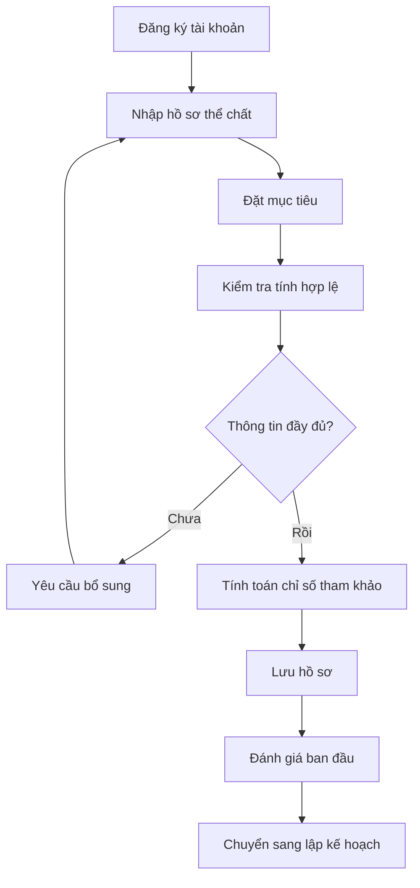
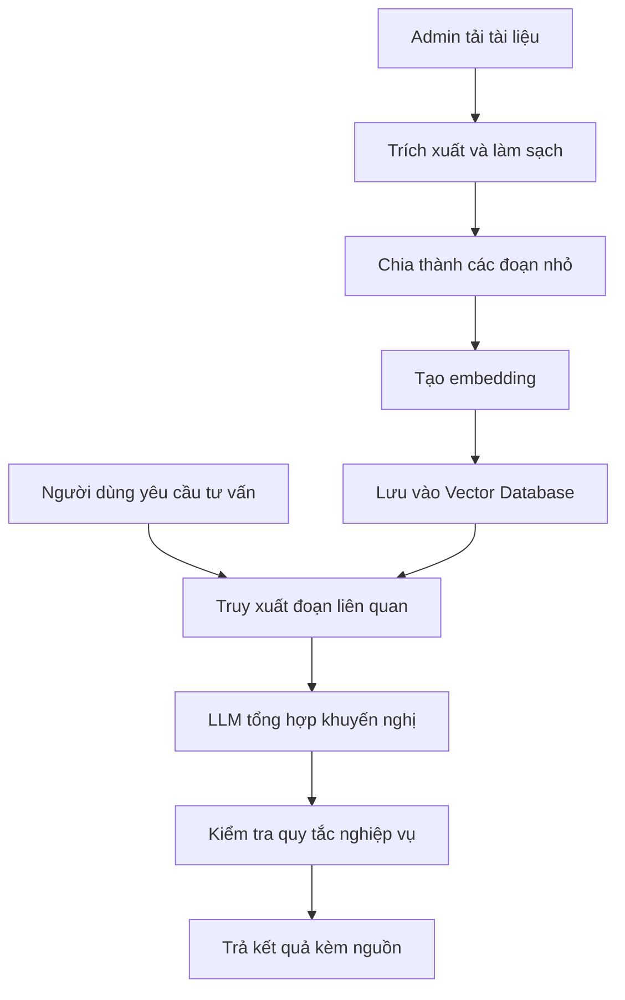
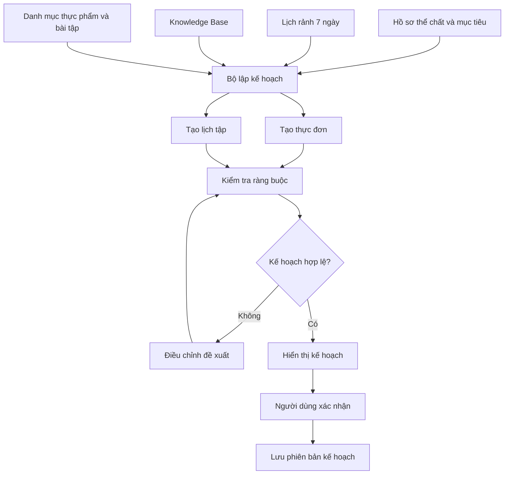
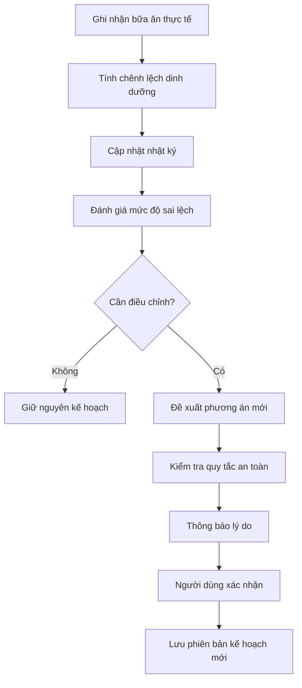

# HEALTH ÁSSISTANT

## Đề tài đồ án: Xây dựng hệ thống AI cá nhân hóa lộ trình dinh dưỡng và tập luyện thể chất

## Định hướng dự án

**Health Assistant** là hệ thống hỗ trợ người dùng quản lý quá trình cải thiện thể chất thông qua trí tuệ nhân tạo, kết hợp dữ liệu cá nhân, cơ sở tri thức chuyên môn (Knowledge Base) và các quy tắc nghiệp vụ để tạo, theo dõi và điều chỉnh lộ trình dinh dưỡng, tập luyện.

Hệ thống tập trung vào ba vấn đề chính:

1. AI sử dụng Knowledge Base để đưa ra lộ trình dinh dưỡng và tập luyện có căn cứ, phù hợp với hồ sơ người dùng.
2. Hệ thống lập kế hoạch trước 7 ngày, dựa trên mục tiêu, thể trạng, điều kiện tập luyện và thời gian rảnh.
3. Hệ thống theo dõi kết quả thực tế, sau đó điều chỉnh lộ trình tương lai khi người dùng ăn uống không đúng kế hoạch, bỏ buổi tập hoặc thay đổi lịch sinh hoạt.

Chức năng nhận diện động tác gym bằng camera được xếp vào phần mở rộng. Ngay cả khi không triển khai được camera trong thời gian quy định, sản phẩm vẫn có thể hoàn thành bài toán chính và có đủ nội dung để đánh giá thực nghiệm.

# PHẦN I. NGHIỆP VỤ CHI TIẾT CỦA DỰ ÁN

## 1. Mục tiêu và phạm vi dự án

### 1.1. Mục tiêu

Xây dựng một hệ thống hỗ trợ người dùng quản lý quá trình cải thiện thể chất thông qua trí tuệ nhân tạo, kết hợp dữ liệu cá nhân, cơ sở tri thức chuyên môn và các quy tắc nghiệp vụ để:

- Đánh giá thể trạng ban đầu dựa trên thông tin người dùng cung cấp.
- Xác định mục tiêu và xây dựng lộ trình dinh dưỡng, tập luyện cá nhân hóa.
- Tạo kế hoạch cuốn chiếu cho 7 ngày tiếp theo, phù hợp với thời gian rảnh của người dùng.
- Theo dõi mức độ tuân thủ kế hoạch thông qua nhật ký ăn uống, tập luyện và cân nặng.
- Điều chỉnh kế hoạch dựa trên kết quả thực tế và những thay đổi trong sinh hoạt.
- Giải thích các khuyến nghị dựa trên kiến thức được lưu trong Knowledge Base.
- Cung cấp báo cáo tiến độ để người dùng đánh giá quá trình thực hiện mục tiêu.

### 1.2. Phạm vi thực hiện

#### Phạm vi bắt buộc

- Quản lý tài khoản và hồ sơ thể chất.
- Đánh giá ban đầu và xác định mục tiêu.
- Quản lý Knowledge Base.
- AI lập kế hoạch ăn uống và tập luyện 7 ngày.
- Quản lý lịch rảnh trong tuần.
- Nhật ký thực hiện và theo dõi cân nặng.
- Điều chỉnh kế hoạch khi dữ liệu thực tế thay đổi.
- Dashboard, báo cáo và kiểm thử.

#### Phạm vi mở rộng

- Nhận diện tư thế tập gym bằng camera.
- Đếm số lần lặp và phát hiện một số lỗi kỹ thuật cơ bản.
- Phản hồi gần thời gian thực trong quá trình tập.

Trong phạm vi đồ án, hệ thống là công cụ hỗ trợ xây dựng thói quen và quản lý thể chất, không phải hệ thống chẩn đoán bệnh hay thay thế bác sĩ, chuyên gia dinh dưỡng hoặc huấn luyện viên.

## 2. Đối tượng sử dụng

| Đối tượng | Nghiệp vụ chính |
|---|---|
| Người dùng | Khai báo thông tin thể chất, đặt mục tiêu, lập lịch rảnh, nhận kế hoạch, ghi nhận kết quả và theo dõi tiến độ. |
| Quản trị viên | Quản lý tài khoản, danh mục bài tập, thực phẩm, tài liệu tri thức và các quy tắc nghiệp vụ. |
| AI Assistant | Phân tích dữ liệu đầu vào, truy xuất kiến thức và đề xuất kế hoạch hoặc điều chỉnh phù hợp. |

AI Assistant là thành phần xử lý của hệ thống, không phải một tài khoản người dùng độc lập.

## 3. Nghiệp vụ quản lý hồ sơ thể chất

### 3.1. Thông tin đầu vào

Người dùng cung cấp:

- Tuổi, chiều cao, cân nặng hiện tại.
- Mục tiêu: giảm cân, duy trì cân nặng hoặc tăng cơ.
- Cân nặng mục tiêu và khoảng thời gian mong muốn.
- Mức độ vận động và kinh nghiệm tập luyện.
- Thói quen ăn uống, số bữa mỗi ngày và thực phẩm cần tránh.
- Điều kiện tập luyện: tại nhà, phòng gym và dụng cụ hiện có.
- Thời gian rảnh dự kiến trong tuần.
- Các hạn chế vận động, chấn thương hoặc yếu tố sức khỏe liên quan nếu người dùng đồng ý cung cấp.

### 3.2. Luồng nghiệp vụ

### 3.3. Kết quả đầu ra

Hệ thống lưu hồ sơ làm dữ liệu đầu vào cho các lần lập kế hoạch tiếp theo, bao gồm:

- Thông tin thể chất và mục tiêu hiện tại.
- Các chỉ số tham khảo được tính toán.
- Điều kiện tập luyện và các giới hạn cần lưu ý.
- Trạng thái hồ sơ đã sẵn sàng lập kế hoạch hay cần bổ sung.

Các chỉ số như BMI hoặc nhu cầu năng lượng chỉ là ước tính tham khảo, không được dùng riêng lẻ để chẩn đoán bệnh hoặc khẳng định khả năng giảm cân.

## 4. Nghiệp vụ quản lý Knowledge Base

Đây là cơ sở tri thức để AI đưa ra khuyến nghị có căn cứ, hạn chế việc tạo ra nội dung thiếu chính xác.

### 4.1. Nội dung tri thức

| Nhóm dữ liệu | Nội dung |
|---|---|
| Dinh dưỡng | Nguyên tắc cân bằng năng lượng, chất dinh dưỡng, khẩu phần và chế độ ăn. |
| Thực phẩm | Thành phần dinh dưỡng, năng lượng tham khảo, khẩu phần và nguyên liệu thay thế. |
| Bài tập | Nhóm cơ, kỹ thuật, dụng cụ, cấp độ, số hiệp và số lần lặp tham khảo. |
| Lập kế hoạch | Nguyên tắc phân bổ buổi tập, nghỉ ngơi, phục hồi và tăng dần cường độ. |
| Điều chỉnh kế hoạch | Xử lý trường hợp ăn sai, bỏ buổi tập, thay đổi lịch rảnh hoặc cân nặng biến động. |
| An toàn | Chống chỉ định cần lưu ý, dấu hiệu nên dừng tập và trường hợp cần tư vấn chuyên môn. |

### 4.2. Quy trình xử lý tài liệu

### 4.3. Quy tắc nghiệp vụ

- Chỉ sử dụng tài liệu được chấp nhận trong Knowledge Base.
- Lưu nguồn tài liệu và thông tin phiên bản.
- Ưu tiên các đoạn kiến thức phù hợp với câu hỏi và hồ sơ người dùng.
- Trả về nguồn tham khảo để người dùng có thể kiểm tra.
- Khi không tìm được kiến thức phù hợp, phải thông báo giới hạn thay vì tự tạo kết luận chắc chắn.

**Nguyên tắc:** Knowledge Base cung cấp căn cứ chuyên môn; các phép tính năng lượng, kiểm tra lịch, giới hạn dinh dưỡng và quy tắc an toàn cần được thực hiện hoặc xác thực bằng logic nghiệp vụ riêng. LLM không được tự ý bỏ qua các ràng buộc này.

## 5. Nghiệp vụ đánh giá thể trạng và xác định mục tiêu

Sau khi hồ sơ hoàn tất, hệ thống thực hiện đánh giá ban đầu để xác định hướng lập kế hoạch phù hợp.

### 5.1. Quy trình xử lý

1. Kiểm tra độ đầy đủ và tính hợp lệ của dữ liệu.
2. Tính các chỉ số tham khảo từ thông tin thể chất.
3. Xác định mục tiêu và mức độ vận động hiện tại.
4. Truy xuất kiến thức liên quan từ Knowledge Base.
5. Đưa ra đánh giá ban đầu, giải thích các yếu tố cần lưu ý.
6. Đề xuất mục tiêu và kế hoạch sơ bộ để người dùng xác nhận.

### 5.2. Dự báo tiến độ

Hệ thống hiển thị xu hướng cân nặng dự kiến, thời gian ước tính để tiến gần mục tiêu và các yếu tố có thể ảnh hưởng đến kết quả.

Hệ thống có thể đưa ra một khoảng cân nặng dự kiến theo từng tuần, sau đó cập nhật dự báo khi có thêm dữ liệu thực tế. Không cam kết người dùng chắc chắn giảm một số kilogram cố định trong một khoảng thời gian, vì cân nặng còn chịu ảnh hưởng của lượng nước, giấc ngủ, vận động và nhiều yếu tố khác.

## 6. Nghiệp vụ lập kế hoạch 7 ngày

Đây là chức năng cốt lõi đầu tiên cần hoàn thiện.

### 6.1. Khai báo lịch rảnh

Người dùng được phép thiết lập nhiều khung giờ rảnh cho mỗi ngày trong tuần.

Thông tin bao gồm:

- Ngày áp dụng.
- Giờ bắt đầu và kết thúc.
- Loại hoạt động có thể thực hiện.
- Địa điểm và dụng cụ tập luyện.
- Các hạn chế hoặc ưu tiên về thời gian.

Ví dụ, người dùng rảnh tối thứ Hai, thứ Tư và thứ Sáu, đồng thời có thể đi bộ vào sáng Chủ Nhật. Hệ thống phải tạo lịch dựa trên các khung giờ đó thay vì áp dụng một lịch tập cố định cho tất cả người dùng.

### 6.2. Quy trình tạo kế hoạch

### 6.3. Kế hoạch dinh dưỡng

Mỗi ngày bao gồm:

- Các bữa ăn và thời gian ăn dự kiến.
- Tên món ăn, nguyên liệu và khẩu phần.
- Năng lượng và thành phần dinh dưỡng ước tính.
- Các lựa chọn thay thế tương đương.
- Danh sách thực phẩm cần mua.
- Hướng dẫn chế biến cơ bản.

Khi người dùng thay đổi món ăn hoặc khẩu phần, hệ thống tính lại tổng dinh dưỡng và kiểm tra các giới hạn đã đặt ra.

### 6.4. Kế hoạch tập luyện

Mỗi buổi tập bao gồm:

- Mục tiêu và nhóm cơ.
- Danh sách bài tập.
- Số hiệp, số lần lặp hoặc thời lượng.
- Thời gian nghỉ.
- Dụng cụ cần thiết.
- Hướng dẫn kỹ thuật và lỗi cần tránh.
- Bài tập thay thế khi không có thiết bị hoặc không phù hợp.

### 6.5. Điều kiện để kế hoạch được chấp nhận

Hệ thống phải kiểm tra tối thiểu:

- Thời lượng buổi tập không vượt quá khung giờ rảnh.
- Các buổi tập có thời gian phục hồi phù hợp.
- Bài tập phù hợp với cấp độ và điều kiện tập luyện.
- Lịch ăn uống đáp ứng các ràng buộc dinh dưỡng đã thiết lập.
- Không vi phạm các giới hạn an toàn.
- Kế hoạch không bị trùng hoặc mâu thuẫn với lịch đã xác nhận.

AI có thể tạo phương án ban đầu, nhưng kế hoạch chỉ được lưu sau khi qua bước kiểm tra.

## 7. Nghiệp vụ theo dõi thực hiện hằng ngày

### 7.1. Nhật ký dinh dưỡng

Người dùng có thể xác nhận đã ăn đúng thực đơn, thay đổi khẩu phần, ghi nhận bữa ăn ngoài kế hoạch hoặc đánh dấu bỏ bữa.

Hệ thống so sánh dữ liệu thực tế với kế hoạch, sau đó cập nhật:

- Tổng năng lượng và chất dinh dưỡng ước tính.
- Mức chênh lệch so với mục tiêu.
- Tỷ lệ tuân thủ thực đơn.
- Các thông tin cần xem xét khi điều chỉnh kế hoạch.

Nếu sử dụng AI nhận diện món ăn qua ảnh, kết quả chỉ là ước tính. Người dùng cần xác nhận món ăn và khẩu phần trước khi lưu nhật ký chính thức.

### 7.2. Nhật ký tập luyện

Người dùng có thể bắt đầu hoặc kết thúc buổi tập, xác nhận bài tập đã hoàn thành, ghi số hiệp, số lần lặp, mức tạ và cảm nhận sau buổi tập.

Các trạng thái bài tập có thể gồm:

- Chưa thực hiện.
- Đang thực hiện.
- Hoàn thành.
- Bỏ qua.
- Hoãn sang thời gian khác.

### 7.3. Theo dõi cân nặng

Người dùng nhập cân nặng theo ngày hoặc theo lịch định kỳ. Hệ thống lưu lịch sử và hiển thị xu hướng so với mục tiêu.

Một lần tăng cân không đồng nghĩa với việc kế hoạch thất bại. Hệ thống cần xem xét xu hướng qua nhiều lần đo, tránh tự động thay đổi khẩu phần hoặc cường độ tập chỉ vì một biến động ngắn hạn.

## 8. Nghiệp vụ điều chỉnh lộ trình thích ứng

Đây là chức năng cốt lõi thứ hai, quyết định tính cá nhân hóa của hệ thống.

### 8.1. Các tình huống cần xử lý

| Tình huống | Hành vi của hệ thống |
|---|---|
| Người dùng ăn đúng kế hoạch | Ghi nhận kết quả và tiếp tục theo dõi. |
| Người dùng ăn vượt kế hoạch | Cập nhật nhật ký, đánh giá mức chênh lệch và xem xét kế hoạch tương lai nếu cần. |
| Người dùng bỏ buổi tập | Kiểm tra lịch còn lại, thời gian phục hồi và đề xuất lịch thay thế phù hợp. |
| Người dùng thay đổi thời gian rảnh | Tạo lịch tập mới từ các khung giờ được cập nhật. |
| Người dùng liên tục không hoàn thành kế hoạch | Đề xuất kế hoạch đơn giản hoặc dễ duy trì hơn. |
| Cân nặng biến động bất thường | Kiểm tra dữ liệu, theo dõi xu hướng và tránh điều chỉnh cực đoan. |
| Người dùng báo đau hoặc chóng mặt | Dừng hoạt động liên quan và hướng dẫn tìm hỗ trợ y tế phù hợp khi cần. |

### 8.2. Luồng xử lý khi ăn sai kế hoạch

Khi người dùng ăn nhiều hơn dự kiến, hệ thống không tự động yêu cầu nhịn ăn vào ngày tiếp theo. Thay vào đó, hệ thống ghi nhận sai lệch, giải thích ảnh hưởng và đánh giá xem có cần thay đổi kế hoạch hay không.

### 8.3. Cơ chế lập kế hoạch cuốn chiếu

Sử dụng cơ chế **Rolling 7-day planning**:

1. Lập kế hoạch cho 7 ngày tiếp theo.
2. Ghi nhận kết quả thực tế của từng ngày.
3. Giữ nguyên lịch sử các ngày đã hoàn thành.
4. Đánh giá lại những ngày chưa thực hiện dựa trên dữ liệu mới.
5. Tạo hoặc cập nhật kế hoạch cho 7 ngày tiếp theo.
6. Hiển thị những thay đổi và lý do để người dùng xác nhận.

Khi người dùng thực hiện tốt, kế hoạch có thể tiếp tục theo định hướng hiện tại. Khi dữ liệu thay đổi, hệ thống điều chỉnh có kiểm soát. Không cần huấn luyện lại mô hình AI mỗi ngày; có thể sử dụng quy tắc nghiệp vụ, dữ liệu nhật ký và RAG để triển khai trong phạm vi đồ án.

## 9. Nghiệp vụ báo cáo và dashboard

Dashboard cung cấp cái nhìn tổng quan về quá trình thực hiện:

- Cân nặng hiện tại và mục tiêu.
- Xu hướng cân nặng theo thời gian.
- Tiến độ hoàn thành thực đơn.
- Số buổi tập đã hoàn thành.
- Lịch tập và thực đơn hôm nay.
- Mức độ tuân thủ kế hoạch.
- Lịch sử thay đổi kế hoạch.
- Các khuyến nghị cần ưu tiên trong thời gian tới.

Cần phân biệt rõ kế hoạch ban đầu, kế hoạch đã điều chỉnh và kết quả thực tế để có thể đánh giá hiệu quả của hệ thống.

## 10. Nghiệp vụ quản trị hệ thống

Quản trị viên thực hiện:

1. Quản lý người dùng và phân quyền.
2. Quản lý danh mục thực phẩm, bài tập và nhóm cơ.
3. Quản lý tài liệu trong Knowledge Base.
4. Theo dõi trạng thái xử lý tài liệu và lỗi truy xuất.
5. Quản lý các quy tắc lập kế hoạch và ngưỡng cảnh báo.
6. Theo dõi lịch sử đề xuất và điều chỉnh.
7. Quản lý phiên bản tri thức và nguồn tham khảo.

Dữ liệu sức khỏe phải được bảo vệ, giới hạn quyền truy cập và chỉ được sử dụng đúng mục đích đã thông báo cho người dùng.

# PHẦN II. KẾ HOẠCH THỰC HIỆN ĐỒ ÁN TRONG 15 TUẦN

Kế hoạch được chia thành đúng 5 đợt theo yêu cầu, với nguyên tắc mỗi đợt tạo ra sản phẩm đầu ra cụ thể để làm cơ sở cho đợt tiếp theo.

## 1. Bảng kế hoạch tổng quát

| Đợt | Nội dung thực hiện | Thời gian | Kết quả dự kiến |
|---|---|---|---|
| 1 | Nghiên cứu cơ sở lý thuyết về AI, RAG, dinh dưỡng, tập luyện và công nghệ liên quan. | Tuần 1–2 | Báo cáo cơ sở lý thuyết, xác định bài toán và lựa chọn công nghệ. |
| 2 | Phân tích yêu cầu, tác nhân, nghiệp vụ lập kế hoạch, theo dõi và điều chỉnh. | Tuần 3–5 | Đặc tả yêu cầu, sơ đồ use case, quy trình nghiệp vụ và tiêu chí nghiệm thu. |
| 3 | Thiết kế kiến trúc, cơ sở dữ liệu, API, giao diện và module AI. | Tuần 6–8 | Sơ đồ kiến trúc, ERD, thiết kế giao diện và tài liệu thiết kế kỹ thuật. |
| 4 | Phát triển backend, frontend, Knowledge Base, AI lập kế hoạch, nhật ký và điều chỉnh. | Tuần 9–12 | Hệ thống tích hợp có thể chạy và trình diễn các nghiệp vụ chính. |
| 5 | Kiểm thử, đánh giá thực nghiệm, hoàn thiện báo cáo và chuẩn bị bảo vệ. | Tuần 13–15 | Sản phẩm hoàn thiện, báo cáo kết quả, slide và kịch bản demo. |

## 2. Kế hoạch chi tiết theo tuần

### Đợt 1. Cơ sở lý thuyết — Tuần 1–2

#### Tuần 1 — Nghiên cứu bài toán

- Tìm hiểu các hệ thống hỗ trợ dinh dưỡng, quản lý cân nặng và tập luyện.
- Nghiên cứu các chỉ số thể chất và nguyên tắc xây dựng kế hoạch cá nhân hóa.
- Tìm hiểu các vấn đề của kế hoạch cố định và nhu cầu điều chỉnh theo kết quả thực tế.
- Xác định mục tiêu, đối tượng sử dụng và phạm vi đồ án.

**Kết quả:** Báo cáo tổng quan bài toán, mục tiêu và phạm vi nghiên cứu.

#### Tuần 2 — Nghiên cứu công nghệ

- Tìm hiểu LLM, prompt engineering, embedding và RAG.
- Nghiên cứu vector database và cơ chế truy xuất tri thức.
- Tìm hiểu công nghệ backend, frontend và lưu trữ dữ liệu.
- Nghiên cứu các phương pháp kiểm thử và đánh giá chất lượng AI.
- Khảo sát MediaPipe và pose estimation ở mức định hướng mở rộng.

**Kết quả:** Báo cáo cơ sở lý thuyết, lựa chọn công nghệ và mô hình giải pháp sơ bộ.

### Đợt 2. Phân tích hệ thống — Tuần 3–5

#### Tuần 3 — Phân tích yêu cầu

- Xác định tác nhân và các chức năng chính.
- Phân tích yêu cầu chức năng và phi chức năng.
- Xây dựng danh sách use case cho người dùng và quản trị viên.
- Xác định yêu cầu bảo mật và giới hạn của hệ thống tư vấn sức khỏe.

**Kết quả:** Danh sách yêu cầu và sơ đồ use case tổng quan.

#### Tuần 4 — Phân tích nghiệp vụ lập kế hoạch

- Phân tích nghiệp vụ đánh giá thể trạng và xác định mục tiêu.
- Phân tích nghiệp vụ tạo thực đơn, lịch tập và lịch rảnh 7 ngày.
- Phân tích nhật ký ăn uống, tập luyện và cân nặng.
- Xây dựng luồng xử lý khi người dùng ăn sai hoặc bỏ buổi tập.

**Kết quả:** Sơ đồ hoạt động, đặc tả use case và bộ quy tắc nghiệp vụ.

#### Tuần 5 — Phân tích nghiệp vụ AI và thích ứng

- Phân tích luồng quản lý Knowledge Base và truy xuất RAG.
- Xác định cách kiểm tra tính hợp lệ của kế hoạch AI.
- Phân tích cơ chế Rolling 7-day planning.
- Xác định các tình huống ngoại lệ và tiêu chí đánh giá hệ thống.
- Chốt chức năng bắt buộc và chức năng mở rộng.

**Kết quả:** Tài liệu đặc tả nghiệp vụ hoàn chỉnh, tiêu chí nghiệm thu và phạm vi triển khai đã chốt.

### Đợt 3. Thiết kế hệ thống — Tuần 6–8

#### Tuần 6 — Thiết kế kiến trúc

- Thiết kế kiến trúc frontend, backend, AI service và các thành phần lưu trữ.
- Xác định ranh giới giữa LLM và logic nghiệp vụ.
- Thiết kế luồng truy xuất tri thức và xác thực kết quả AI.
- Xây dựng sơ đồ thành phần và sơ đồ triển khai.

**Kết quả:** Tài liệu kiến trúc tổng thể.

#### Tuần 7 — Thiết kế cơ sở dữ liệu và API

- Thiết kế ERD cho tài khoản, hồ sơ, mục tiêu, thực phẩm và bài tập.
- Thiết kế dữ liệu lịch rảnh, kế hoạch, nhật ký và lịch sử điều chỉnh.
- Thiết kế các bảng quản lý nguồn tri thức và phiên bản kế hoạch.
- Xác định REST API, request/response và quy tắc xác thực.

**Kết quả:** ERD, tài liệu API và thiết kế dữ liệu.

#### Tuần 8 — Thiết kế giao diện và module AI

- Thiết kế dashboard, hồ sơ thể chất, lịch 7 ngày và nhật ký.
- Thiết kế màn hình thực đơn, buổi tập và báo cáo tiến độ.
- Thiết kế giao diện quản trị Knowledge Base.
- Xác định cấu trúc prompt, metadata và tiêu chí kiểm tra đầu ra.
- Chuẩn bị dữ liệu mẫu phục vụ phát triển.

**Kết quả:** Bộ thiết kế giao diện, tài liệu module AI và tài liệu thiết kế hoàn chỉnh.

### Đợt 4. Phát triển chức năng và thực nghiệm — Tuần 9–12

#### Tuần 9 — Xây dựng nền tảng

- Khởi tạo dự án và cấu hình môi trường.
- Xây dựng đăng nhập, phân quyền và quản lý hồ sơ thể chất.
- Xây dựng chức năng đặt mục tiêu và khai báo lịch rảnh.
- Xây dựng danh mục thực phẩm và bài tập ở mức cơ bản.

**Kết quả:** Nền tảng backend, frontend và dữ liệu nghiệp vụ cơ bản.

#### Tuần 10 — Xây dựng Knowledge Base và AI lập kế hoạch

- Xây dựng quy trình tải lên, xử lý và lưu trữ tài liệu.
- Tích hợp embedding, vector database và RAG.
- Xây dựng chức năng tạo thực đơn và lịch tập 7 ngày.
- Bổ sung bước kiểm tra ràng buộc trước khi lưu kế hoạch.

**Kết quả:** AI có thể truy xuất kiến thức và tạo kế hoạch theo hồ sơ mẫu.

#### Tuần 11 — Xây dựng theo dõi và điều chỉnh

- Xây dựng nhật ký ăn uống, tập luyện và cân nặng.
- Xây dựng chức năng so sánh kế hoạch với thực tế.
- Xử lý các trường hợp ăn sai, bỏ buổi và thay đổi lịch.
- Xây dựng cơ chế lập kế hoạch cuốn chiếu.
- Hoàn thiện dashboard và biểu đồ tiến độ.

**Kết quả:** Hệ thống có thể theo dõi việc thực hiện và điều chỉnh kế hoạch tương lai.

#### Tuần 12 — Tích hợp và thực nghiệm ban đầu

- Tích hợp các module thành luồng nghiệp vụ hoàn chỉnh.
- Kiểm thử các kịch bản lập kế hoạch và điều chỉnh.
- Ghi nhận lỗi, thời gian phản hồi và kết quả đầu ra.
- Nếu các chức năng cốt lõi đã ổn định, triển khai thử nhận diện một hoặc hai bài tập bằng camera.

**Kết quả:** Phiên bản hệ thống tích hợp, bộ kịch bản thử nghiệm và số liệu ban đầu.

### Đợt 5. Kiểm thử và hoàn thiện — Tuần 13–15

#### Tuần 13 — Kiểm thử chức năng

- Kiểm thử đăng nhập, hồ sơ và phân quyền.
- Kiểm thử tạo thực đơn, lịch tập và lịch rảnh.
- Kiểm thử nhật ký, tính toán dinh dưỡng và điều chỉnh kế hoạch.
- Kiểm thử truy xuất Knowledge Base và nguồn tham khảo.
- Sửa lỗi và thực hiện kiểm thử hồi quy.

**Kết quả:** Báo cáo kiểm thử chức năng và phiên bản đã sửa lỗi.

#### Tuần 14 — Đánh giá kết quả thực nghiệm

- Đánh giá tính hợp lệ và mức độ phù hợp của kế hoạch AI.
- Đánh giá chất lượng truy xuất RAG trên bộ câu hỏi mẫu.
- Đo thời gian phản hồi và tỷ lệ kịch bản kiểm thử đạt.
- Đánh giá khả năng thích ứng qua các tình huống giả lập.
- Tổng hợp kết quả, phân tích hạn chế và đề xuất cải tiến.

**Kết quả:** Bảng số liệu, biểu đồ và báo cáo đánh giá thực nghiệm.

#### Tuần 15 — Hoàn thiện và chuẩn bị bảo vệ

- Hoàn thiện báo cáo đồ án và tài liệu hướng dẫn.
- Hoàn thiện sơ đồ, hình ảnh minh họa và kết quả thực nghiệm.
- Chuẩn bị slide và kịch bản trình diễn hệ thống.
- Chuẩn bị dữ liệu mẫu, tài khoản demo và phương án dự phòng.
- Tổng hợp hạn chế và hướng phát triển tiếp theo.

**Kết quả:** Sản phẩm cuối cùng, báo cáo, slide và kịch bản bảo vệ.

# PHẦN III. ĐÁNH GIÁ ĐỒ ÁN

## 1. Bộ tiêu chí thực nghiệm

Để đồ án có tính khoa học, cần chứng minh hệ thống hoạt động đúng và AI tạo ra kết quả phù hợp. Không cần chứng minh người dùng thật chắc chắn giảm được bao nhiêu kilogram trong thời gian thực hiện đồ án.

| Nội dung | Phương pháp đánh giá | Kết quả cần thu thập |
|---|---|---|
| Tính đúng đắn nghiệp vụ | Chạy các kịch bản kiểm thử | Số kịch bản đạt và không đạt. |
| Chất lượng RAG | So sánh tài liệu truy xuất với nguồn tham chiếu | Mức độ liên quan, độ chính xác của nguồn. |
| Chất lượng kế hoạch AI | Đối chiếu với bộ tiêu chí nghiệp vụ | Tỷ lệ kế hoạch đáp ứng các ràng buộc. |
| Khả năng cá nhân hóa | Thử trên các hồ sơ và lịch rảnh khác nhau | Mức độ phù hợp của kế hoạch với từng hồ sơ. |
| Khả năng thích ứng | Thử các trường hợp ăn sai, bỏ buổi, đổi lịch | Kế hoạch sau điều chỉnh và tính hợp lệ của thay đổi. |
| Hiệu năng | Đo thời gian xử lý API và tạo kế hoạch | Thời gian phản hồi trong môi trường thử nghiệm. |
| Trải nghiệm người dùng | Cho người dùng thử và khảo sát | Mức độ dễ sử dụng, mức độ hài lòng. |

Nên chuẩn bị một bộ dữ liệu kiểm thử gồm hồ sơ thể chất giả lập, tài liệu tri thức đã kiểm duyệt, câu hỏi có đáp án tham chiếu và các tình huống thay đổi kế hoạch. Tất cả kết quả cần được đo thực tế, không tự đặt ra số liệu thành tích.

## 2. Công nghệ sử dụng

Bảng dưới tổng hợp stack được sử dụng cho giải pháp Health Assistant, gồm nền tảng hiện có và công nghệ chuyên biệt cho RAG/camera trong phạm vi đề tài.

| Thành phần | Công nghệ sử dụng | Vai trò |
|---|---|---|
| Mobile | React Native 0.86.3, Expo SDK 57.0.27, React 19.2.3, TypeScript ~6.0.3 | Xây dựng ứng dụng iOS/Android và giao diện Web. |
| Điều hướng và trạng thái | React Navigation 7, Zustand 5 | Điều hướng màn hình và quản lý trạng thái phiên/nghiệp vụ phía client. |
| Camera chụp/quét | `expo-camera` | Mở camera, hướng dẫn người dùng chụp chính diện/nghiêng và lấy ảnh đầu vào cho xử lý pose cục bộ. |
| Camera realtime | `react-native-vision-camera` và frame output/native plugin | Đọc frame camera cho bài tập realtime; dùng Expo development build/EAS vì cần mã native, không chạy bằng Expo Go hoặc Web. |
| Pose estimation | MediaPipe Tasks Vision (Kotlin Android, Swift iOS); MediaPipe Tasks Vision JavaScript cho Web | Trích xuất landmark/visibility tại thiết bị; app gửi điểm hoặc chỉ số cần thiết, không gửi video thô cho Gemini. |
| API client và lưu token | Fetch API qua `src/api/client.ts`, Expo SecureStore trên native | Gọi REST API, truyền JWT; Web giữ token trong bộ nhớ phiên. |
| Backend | Java 17, Spring Boot 3.2.3, Spring Web, WebFlux, Validation, Spring Security | REST API, xác thực, validation, luật nghiệp vụ và tích hợp Gemini/Qdrant. |
| Truy cập dữ liệu | Spring Data JPA, MyBatis Spring Boot Starter 3.0.3 | Lưu entity và thực hiện truy vấn SQL theo các module backend. |
| Cơ sở dữ liệu quan hệ | MySQL 8.0, MySQL Connector/J | Lưu tài khoản, hồ sơ, posture report, roadmap, daily plan và workout. |
| AI tạo nội dung | Google Gemini API qua backend `GeminiClient` | Sinh roadmap, daily plan và phản hồi có cấu trúc; backend kiểm tra schema, quy tắc an toàn và fallback. API key chỉ đặt ở backend environment. |
| Embedding và RAG | Gemini Embedding API + quy trình ingest/chunk/retrieve trong backend Java | Tạo vector cho tài liệu tri thức và câu hỏi; truy xuất đoạn liên quan để đưa làm context cho Gemini. |
| Vector database | Qdrant | Lưu embedding cùng metadata nguồn/chủ đề và tìm các đoạn tri thức tương đồng; chạy cùng MySQL qua Docker Compose. |
| Ảnh đại diện | Cloudinary SDK 2.5.0 | Upload ảnh đại diện có ký xác thực; ảnh tư thế được xử lý cục bộ, không dùng avatar làm dữ liệu đánh giá. |
| Tài liệu API | Springdoc OpenAPI 2.3.0 | Sinh giao diện và đặc tả REST API backend. |
| Kiểm thử | JUnit 5, Mockito/AssertJ qua Spring Boot Test, Spring Security Test; TypeScript/ESLint cho mobile | Kiểm thử nghiệp vụ, schema/fallback, API/bảo mật và chất lượng mã client. |
| Build và môi trường | Gradle 8.8 Wrapper, Node.js 22.13, npm, Expo/EAS, Docker Compose | Build backend/mobile; dựng MySQL và Qdrant phục vụ phát triển, kiểm thử. |

Luồng RAG: tài liệu có nguồn → chuẩn hóa/chia đoạn → Gemini tạo embedding → lưu vector và metadata vào Qdrant → truy xuất theo câu hỏi → gửi đoạn phù hợp cùng hồ sơ tối thiểu cho Gemini tạo câu trả lời. Kích thước vector lưu trong Qdrant phải khớp cấu hình embedding đã chọn. [Gemini Embeddings](https://ai.google.dev/gemini-api/docs/embeddings), [Qdrant Collections](https://qdrant.tech/documentation/manage-data/collections/).

Luồng camera: Expo Camera/VisionCamera → MediaPipe trên thiết bị → landmark và visibility → API posture/workout hiện có → luật backend → UI hiển thị kết quả có ngưỡng tin cậy. MediaPipe hỗ trợ xử lý ảnh đơn, video và livestream trên Android/iOS; camera realtime yêu cầu native development build. [MediaPipe Pose Android](https://developers.google.com/edge/mediapipe/solutions/vision/pose_landmarker/android), [MediaPipe Pose iOS](https://developers.google.com/edge/mediapipe/solutions/vision/pose_landmarker/ios), [Expo Camera SDK 57](https://docs.expo.dev/versions/v57.0.0/sdk/camera/), [VisionCamera Frame Output](https://visioncamera.margelo.com/docs/frame-output).

Không huấn luyện LLM riêng. Gemini tạo nội dung; backend Java chịu trách nhiệm kiểm tra schema, số liệu, quyền dữ liệu và quy tắc an toàn. Ảnh/video cơ thể không gửi tới Gemini; chỉ sử dụng landmark/metadata tối thiểu sau khi xử lý tại thiết bị và có consent phù hợp.

## 3. Sản phẩm cần bàn giao

- [ ] Tài liệu cơ sở lý thuyết và phân tích nghiệp vụ.
- [ ] Sơ đồ use case, activity diagram, kiến trúc và ERD.
- [ ] Mã nguồn frontend và backend.
- [ ] Knowledge Base mẫu cùng quy trình truy xuất RAG.
- [ ] Chức năng lập thực đơn và lịch tập 7 ngày.
- [ ] Chức năng theo dõi ăn uống, tập luyện và cân nặng.
- [ ] Cơ chế điều chỉnh kế hoạch theo dữ liệu thực tế.
- [ ] Dashboard báo cáo tiến độ.
- [ ] Bộ dữ liệu và kịch bản kiểm thử.
- [ ] Báo cáo thực nghiệm có số liệu đo được.
- [ ] Báo cáo đồ án, slide và kịch bản demo.

## 4. Kết luận và định hướng triển khai

Trong 15 tuần, cần tập trung hoàn thiện vòng lặp nghiệp vụ:

**Đánh giá thể trạng → Tạo kế hoạch 7 ngày → Người dùng thực hiện → Ghi nhận dữ liệu → Đánh giá sai lệch → Điều chỉnh kế hoạch tiếp theo.**

Điểm đáng giá nhất của đề tài không chỉ là tích hợp chatbot AI, mà là xây dựng hệ thống kết hợp tri thức chuyên môn, dữ liệu cá nhân và quy tắc nghiệp vụ để tạo ra kế hoạch có thể kiểm tra, theo dõi và điều chỉnh.

Module camera gym sẽ giúp tăng tính trực quan và độ khó kỹ thuật, nhưng chỉ nên triển khai sau khi vòng lặp nghiệp vụ chính đã hoạt động ổn định. Đây là cách phân bổ nguồn lực phù hợp để đồ án vừa có chiều sâu AI, vừa có đầy đủ nghiệp vụ phần mềm và có thể bảo vệ bằng kết quả thực nghiệm.
