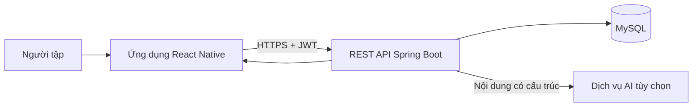

# ĐỒ ÁN: ỨNG DỤNG HỖ TRỢ SỨC KHỎE VÀ LUYỆN TẬP CÁ NHÂN

> Kế hoạch 15 tuần, tổ chức thành 7 đợt: 6 đợt x 2 tuần và đợt cuối x 3 tuần. Đây là kế hoạch thực hiện, không phải xác nhận các tính năng đã hoàn thành.

## Mục lục

- [1. Tổng quan](#1-tổng-quan)
- [2. Phạm vi và giả định](#2-phạm-vi-và-giả-định)
- [3. Cơ sở kỹ thuật cần nắm](#3-cơ-sở-kỹ-thuật-cần-nắm)
- [4. Phân tích và thiết kế](#4-phân-tích-và-thiết-kế)
- [5. Lộ trình 7 đợt / 15 tuần](#5-lộ-trình-7-đợt--15-tuần)
- [6. Bảng theo dõi tiến độ](#6-bảng-theo-dõi-tiến-độ)
- [7. Kiểm thử, đánh giá và triển khai](#7-kiểm-thử-đánh-giá-và-triển-khai)
- [8. Báo cáo và bảo vệ](#8-báo-cáo-và-bảo-vệ)
- [9. Checklist tổng thể](#9-checklist-tổng-thể)
- [10. Tài liệu tham khảo](#10-tài-liệu-tham-khảo)
- [11. Tiến độ hiện tại](#11-tiến-độ-hiện-tại)

## 1. Tổng quan

### Tên đề tài

**Xây dựng ứng dụng di động hỗ trợ theo dõi tư thế và cá nhân hóa kế hoạch luyện tập với trợ lý AI.**

Tên có thể điều chỉnh theo mẫu của trường. Sản phẩm gồm ứng dụng di động `heathreact` (Expo/React Native, TypeScript) và backend `HealthAssistantProject` (Java 17, Spring Boot, REST API, MySQL). Trong mã hiện có các nhóm màn hình hồ sơ, quét tư thế, lộ trình, kế hoạch ngày, huấn luyện, tiến độ và coach; backend có các module tương ứng về auth, profile, posture, coach, daily plan và progress. Đây là quan sát cấu trúc, không thay cho kiểm thử chức năng.

### Bối cảnh, bài toán và mục tiêu

Người tập tại nhà thường khó duy trì lịch tập, theo dõi tiến độ và tự nhận biết một số lỗi tư thế cơ bản. Đồ án xây dựng một công cụ hỗ trợ ghi nhận thông tin người dùng, đưa ra kế hoạch tập có cấu trúc, hỗ trợ đánh giá tư thế dựa trên landmark đầu vào và tổng hợp tiến độ. AI có thể diễn giải hoặc đề xuất nội dung có giới hạn; các quy tắc an toàn và tính toán xác định phải được kiểm soát bởi ứng dụng.

- **Mục tiêu học thuật:** phân tích yêu cầu, thiết kế app-client/API/backend/database; tìm hiểu xử lý landmark, kiểm thử phần mềm và đánh giá đầu ra AI có cấu trúc.
- **Mục tiêu sản phẩm:** hoàn thành một luồng MVP có thể trình diễn từ đăng nhập, khai báo hồ sơ đến xem kế hoạch, ghi nhận buổi tập và xem tiến độ; quét tư thế/coach được đưa vào MVP nếu luồng camera và dịch vụ hoạt động ổn định.
- **Đối tượng:** người trưởng thành muốn tập luyện thể chất phổ thông tại nhà; quản trị viên chỉ trong phạm vi quản lý tài khoản/demo nếu chức năng này cần thiết.
- **Kết quả dự kiến:** mã nguồn hai phần, hợp đồng API, thiết kế dữ liệu, bộ test và kết quả chạy thực tế, hướng dẫn cài đặt, báo cáo và kịch bản demo.

### Phạm vi nghiên cứu và phương pháp

Nghiên cứu REST/client-server, React Native/Expo, Spring Boot, xác thực JWT, mô hình dữ liệu quan hệ, xử lý landmark/đếm lần lặp theo luật, tích hợp LLM có kiểm tra schema và an toàn. Thực hiện theo vòng lặp: khảo sát mã hiện có, xác định luồng ưu tiên, thiết kế, triển khai từng lát cắt dọc mobile-API-database, kiểm thử, ghi nhận kết quả và cập nhật thiết kế khi có bằng chứng.

## 2. Phạm vi và giả định

### MVP ưu tiên

1. Đăng ký/đăng nhập và truy cập API có JWT.
2. Tạo/xem hồ sơ tập luyện của chính người dùng.
3. Tạo hoặc lấy lộ trình và kế hoạch ngày; có phản hồi an toàn khi AI lỗi.
4. Ghi nhận buổi tập và tổng hợp tiến độ cơ bản.
5. Kết nối các màn hình mobile với backend, thể hiện trạng thái tải/lỗi/rỗng và xử lý phiên đăng nhập.

Đánh giá tư thế qua landmark, đếm rep thời gian thực và chat AI là chức năng nâng cao có điều kiện: chỉ đưa vào bản demo chính nếu có dữ liệu kiểm tra, độ tin cậy được thể hiện và xử lý camera/AI ổn định. Không mở rộng thành tư vấn dinh dưỡng/y khoa, chẩn đoán bệnh, nhận diện mọi bài tập, social, thanh toán hoặc dashboard vận hành hoàn chỉnh.

### Hiện trạng quan sát được trong repository

- Mobile có các trang `Login`, `Home`, `Scan`, `Roadmap`, `DailyPlan`, `Workout`, `Progress`, `Profile`, `Coach`; có API service và cấu hình điều hướng.
- Backend có controller/service cho auth, profile, posture assess/report, roadmap/chat, pose angle, workout tracking/end, daily plan today và progress summary. Có test cho `PostureAssessmentService` và `ExerciseRepService`.
- Backend khai báo Java 17, Spring Boot, JPA, MyBatis, Spring Security, JWT, OpenAPI, MySQL; mobile hiện dùng Expo SDK 57, React Native 0.86 và TypeScript.
- Tên file, checklist và endpoint hiện có không chứng minh luồng đã hoạt động end-to-end. Đợt đầu phải chạy baseline, kiểm tra cấu hình và ghi lỗi trước khi sửa.

### Giả định, giới hạn và rủi ro

- Kế hoạch giả định một sinh viên hoặc nhóm nhỏ, 15 tuần, có máy Android và môi trường phát triển Java/Node/MySQL. iOS là mục tiêu phụ nếu không có thiết bị phù hợp.
- Cần xác nhận quy định báo cáo, mẫu trường, thiết bị demo và quyền sử dụng dữ liệu/video. Không dùng ảnh/video sức khỏe của người khác khi chưa có đồng ý.
- Landmark từ camera 2D bị ảnh hưởng bởi góc đặt máy, che khuất, ánh sáng, kích thước khung hình và khác biệt cơ thể. Kết quả không phải đánh giá y khoa.
- Không ghi API key, JWT secret, mật khẩu hoặc dữ liệu định danh vào Git/log. Không tuyên bố độ chính xác, hiệu năng hay lợi ích sức khỏe nếu chưa đo.

## 3. Cơ sở kỹ thuật cần nắm

| Chủ đề | Cần hiểu và áp dụng trong đồ án | Cách kiểm chứng |
|---|---|---|
| Client-server và REST | Mobile gửi HTTP request; backend xác thực, kiểm tra dữ liệu, thực hiện nghiệp vụ và trả response có quy ước. | Đối chiếu request/response với API chạy trên Swagger/Postman và app. |
| React Native/Expo | Component, state, navigation, quyền camera, cấu hình môi trường; không giả định API web hoạt động giống native. | Chạy thiết bị/emulator, kiểm tra quyền, trạng thái offline/loading/error. |
| Spring Boot | Controller nhận request, DTO validation, service chứa nghiệp vụ, repository truy cập dữ liệu, exception handler chuẩn hóa lỗi. | Unit/integration test theo từng lớp và luồng. |
| JWT và bảo mật | Token được gửi qua Authorization; backend xác minh chữ ký/hạn dùng; chỉ lấy dữ liệu theo danh tính đã xác thực. | Token thiếu/sai/hết hạn và thử truy cập chéo tài khoản. |
| MySQL và mô hình dữ liệu | Khóa, quan hệ, ràng buộc, transaction; dữ liệu sức khỏe gắn đúng người dùng. | Migration/schema, truy vấn kiểm tra tính toàn vẹn và test transaction. |
| Landmark và luật tư thế | Tọa độ/visibility, chuẩn hóa, góc hình học, ngưỡng, FSM cho rep; dữ liệu thấp tin cậy phải từ chối kết luận. | Fixture landmark tự tạo/được phép sử dụng, trường hợp biên và video test có nhãn. |
| LLM có cấu trúc | Model có thể trả lời sai hoặc sai schema; validate, giới hạn timeout, fallback và lưu phiên bản prompt/model phù hợp. | Bộ ca hợp lệ, sai schema, timeout, nội dung ngoài phạm vi/an toàn. |
| Kiểm thử | Unit kiểm tra quy tắc nhỏ; integration kiểm tra ranh giới DB/API; E2E kiểm tra luồng người dùng. | Gắn ID test case, dữ liệu, bước, mong đợi và kết quả thực chạy. |

Ưu tiên tài liệu chính thức tương ứng với phiên bản thực tế trong lockfile/build file. Ghi rõ định nghĩa, vai trò, lý do chọn, giới hạn và phương án thay thế trong chương cơ sở lý thuyết; không đưa công nghệ AI/ML mới vào nếu không đủ dữ liệu và thời gian đánh giá.

## 4. Phân tích và thiết kế

### Tác nhân và use case MVP

- **Người dùng:** đăng ký/đăng nhập, cập nhật hồ sơ, xem/tạo kế hoạch, ghi nhận tập luyện, xem tiến độ; yêu cầu coach nếu phạm vi cho phép.
- **Dịch vụ AI bên ngoài:** nhận đầu vào giới hạn, trả nội dung đề xuất; có thể timeout, trả dữ liệu lỗi hoặc không khả dụng.
- **Quản trị viên:** chỉ đưa vào nếu đồ án cần minh họa quản lý tài khoản; không để lấn át luồng người tập.

### Kiến trúc và ranh giới trách nhiệm

App chịu trách nhiệm giao diện, quyền thiết bị, trạng thái phiên và hiển thị kết quả. Backend chịu trách nhiệm xác thực, quyền sở hữu dữ liệu, validation, nghiệp vụ, persistence và gọi dịch vụ ngoài. Mobile không tự tin cậy userId do client gửi; backend lấy danh tính từ principal/token. Tính toán định lượng/quy tắc an toàn cần xác định được thì không giao toàn bộ cho LLM.

### Nhóm dữ liệu cần đặc tả

Đối chiếu schema thực tế trước khi chốt ERD: User/Role, UserProfile và ràng buộc sức khỏe, PostureReport, RoadmapRecord, DailyPlan (nếu persist), WorkoutSession, lịch sử tương tác AI nếu thực sự lưu. Với mỗi bảng ghi khóa, kiểu dữ liệu, nullable, quan hệ, chỉ mục, quyền đọc/ghi, thời hạn lưu và dữ liệu nhạy cảm. Tránh lưu camera frame/video nếu không cần cho MVP.

### Hợp đồng API

Các route dưới đây được phát hiện trong controller hiện tại; kiểm tra prefix/version, HTTP status, DTO, security và response thực tế trước khi đưa vào đặc tả cuối. Không coi danh sách này là bảo đảm API đã chạy.

| Nhóm | Route quan sát được |
|---|---|
| Auth | `POST /auth/login`, `POST /auth/signup`, `GET /auth/profile` |
| Profile | `POST /profiles`, `GET /profiles/me` |
| Posture | `POST /posture/assess`, `GET /posture/reports/me` |
| Coach | `POST /coach/roadmap`, `GET /coach/roadmaps/me`, `POST /coach/chat` |
| Workout/Pose | `POST /workout-engine/track`, `POST /workout-engine/end`, `POST /pose-engine/angle` |
| Daily plan/Progress | `GET /daily-plans/today`, `GET /progress/summary` |

Mỗi API cần đặc tả auth, request/response mẫu, validation, lỗi 400/401/403/404/409/5xx phù hợp và quyền sở hữu dữ liệu. Chuẩn hóa lỗi để app phân biệt lỗi nhập liệu, hết phiên, mất mạng và lỗi dịch vụ.

## 5. Lộ trình 7 đợt / 15 tuần

Mỗi đợt kéo dài 2 tuần, ngoại trừ đợt 7 kéo dài 3 tuần. Bên trong vẫn có đầu ra/nghiệm thu theo từng tuần để theo dõi tiến độ; tuần sau chỉ bắt đầu khi lưu được đầu ra tuần trước hoặc ghi rõ ngoại lệ/rủi ro.

### Đợt 1 — Khảo sát, chốt phạm vi và yêu cầu (Tuần 1–2, 2 tuần)

**Mục tiêu/kiến thức:** xác định bài toán thật, đối tượng, use case, MVP; phân biệt yêu cầu chức năng và phi chức năng. Học cách khảo sát repository và viết tiêu chí chấp nhận có thể kiểm tra.

**Tuần 1 — Baseline và đề cương.** Chạy riêng mobile/backend theo README/config; ghi môi trường, lệnh, lỗi, endpoint khả dụng và ảnh màn hình. Đọc các trang app, service API, controller và schema. Chốt mục tiêu, đối tượng, giới hạn và ưu tiên tính năng. Không sửa lỗi nền tảng trước khi có log baseline.

- Đầu ra: đề cương 1–2 trang; sơ đồ luồng hiện trạng; bảng chức năng `đã quan sát / chưa xác minh / ngoài MVP`; nhật ký chạy baseline.
- Nghiệm thu: có thể trình bày bài toán trong 1 phút; phân biệt được mã có mặt với luồng đã kiểm thử; có bằng chứng lệnh chạy hoặc lỗi tái hiện.
- Tự hỏi: Người dùng gặp vấn đề gì? Bằng chứng nào chứng minh một màn hình đang gọi backend thật?

**Tuần 2 — Yêu cầu và use case.** Mô tả tác nhân, luồng đăng nhập, tạo hồ sơ, lấy kế hoạch, hoàn thành buổi tập và xem tiến độ. Với mỗi luồng ghi tiền/hậu điều kiện, luồng lỗi và dữ liệu cần bảo vệ. Chuyển yêu cầu thành tiêu chí chấp nhận.

- Đầu ra: SRS ngắn; use case/flow; danh sách quy tắc nghiệp vụ; backlog MVP và ngoài phạm vi.
- Nghiệm thu: mỗi yêu cầu MVP có ID, tác nhân, tiêu chí pass/fail và liên kết tới màn hình/API dự kiến.
- Tự hỏi/phản biện: vì sao chatbot hoặc đếm rep có thể để ngoài MVP? Cách xử lý khi AI không phản hồi?
- Điều kiện chuyển đợt: phạm vi, người dùng, luồng chính và giới hạn sức khỏe được chốt; báo cáo ghi rõ giả định.
- Báo cáo: chương 1 và phần phân tích yêu cầu chương 2.

### Đợt 2 — Nghiên cứu, kiến trúc và hợp đồng (Tuần 3–4, 2 tuần)

**Mục tiêu/kiến thức:** hiểu công nghệ đang dùng và lý do lựa chọn; mô hình hóa kiến trúc, luồng dữ liệu, bảo mật và phụ thuộc ngoài.

**Tuần 3 — Cơ sở lý thuyết và quyết định công nghệ.** Nghiên cứu client-server, React Native/Expo, REST, Spring Boot, JWT, MySQL, pose landmark và LLM có kiểm soát. Với mỗi chủ đề ghi khái niệm, vai trò, ưu/nhược, thay thế và nguồn chính thức phù hợp phiên bản.

- Đầu ra: bản nháp cơ sở lý thuyết; bảng quyết định công nghệ (ADR ngắn); danh sách kiến thức cần bổ sung.
- Nghiệm thu: mọi công nghệ trong sơ đồ có vai trò cụ thể; không nêu độ chính xác hoặc hiệu quả AI chưa đo.

**Tuần 4 — Kiến trúc và luồng nghiệp vụ.** Vẽ component/container, sequence đăng nhập và lấy kế hoạch, luồng ghi buổi tập; xác định module, boundary app/backend/AI/database và các lỗi/mất kết nối. Kiểm tra sơ đồ dựa vào code hiện tại, ghi sai khác thay vì vẽ theo mong muốn.

- Đầu ra: sơ đồ kiến trúc, sequence/hoạt động cho 2–3 luồng, ADR về xác thực, tích hợp AI và nơi áp dụng quy tắc an toàn.
- Nghiệm thu: sơ đồ có request, response, persistence và nhánh lỗi; mỗi module khớp một khu vực source hoặc được đánh dấu dự kiến.
- Tự hỏi/phản biện: nếu Gemini hỏng, phần nào còn sử dụng được? Vì sao backend là nguồn tin cậy về user identity?
- Điều kiện chuyển đợt: kiến trúc và MVP thống nhất; mọi khác biệt giữa thiết kế và hiện trạng được ghi nhận.
- Báo cáo: chương cơ sở lý thuyết và chương phân tích/thiết kế.

### Đợt 3 — Mô hình dữ liệu, API và nền chạy ổn định (Tuần 5–6, 2 tuần)

**Mục tiêu/kiến thức:** thiết kế dữ liệu/API trước tích hợp; hiểu DTO, validation, lỗi, migration/config và cách quản lý bí mật.

**Tuần 5 — ERD và API contract.** Đọc SQL init, entity, repository và DTO; lập ERD phản ánh schema thật. Đặc tả API MVP, quyền truy cập, validation, status/error và ví dụ JSON. Đánh dấu chỗ thiếu hoặc bất nhất giữa mobile service và controller.

- Đầu ra: ERD; data dictionary; danh mục API/OpenAPI hoặc Postman; ma trận quyền; bảng ánh xạ endpoint mobile-backend.
- Nghiệm thu: ID/quan hệ/ràng buộc nhất quán; request-response khớp DTO; dữ liệu người dùng không truy cập chỉ bằng userId client cung cấp.

**Tuần 6 — Môi trường và vertical slice đầu tiên.** Chuẩn hóa hướng dẫn chạy app, backend, DB; cấu hình URL theo môi trường; không commit secrets. Chạy auth hoặc profile end-to-end, tạo test API smoke và ghi phiên bản công cụ.

- Đầu ra: README chạy local; cấu hình mẫu không chứa bí mật; bản chạy app/backend/DB; smoke test một luồng.
- Nghiệm thu: thành viên khác có thể làm theo hướng dẫn; lỗi môi trường có thông báo rõ; test chứng minh API và DB kết nối.
- Tự hỏi/phản biện: token được lưu và gửi thế nào? Vì sao không để credential trong source?
- Điều kiện chuyển đợt: môi trường tái lập được và hợp đồng đầu tiên khớp ở cả hai phía.
- Báo cáo: ERD, data dictionary, API contract và môi trường thực nghiệm.

### Đợt 4 — Nghiệp vụ lõi và tích hợp app/backend (Tuần 7–8, 2 tuần)

**Mục tiêu/kiến thức:** triển khai lát cắt dọc theo thứ tự giá trị; hiểu controller-service-repository, state UI và xử lý lỗi mạng.

**Tuần 7 — Auth, profile và quyền sở hữu dữ liệu.** Hoàn thiện hoặc sửa luồng đăng ký/đăng nhập/profile theo code đã kiểm tra. Đảm bảo API yêu cầu JWT phù hợp; kiểm tra dữ liệu của user A không thể đọc/sửa bởi user B. Trên app xử lý token, hết phiên, loading và validation.

- Đầu ra: luồng auth/profile chạy được; test backend và checklist app; ảnh chụp luồng thành công/lỗi.
- Nghiệm thu: token sai/thiếu bị từ chối; user chỉ xem dữ liệu của mình; lỗi nhập liệu có thể hiểu và sửa.

**Tuần 8 — Kế hoạch ngày, buổi tập, tiến độ.** Nối trang kế hoạch/Workout/Progress với API thật theo ưu tiên. Xác định dữ liệu nào được lưu và nguồn tổng hợp; nếu AI sinh kế hoạch, validate schema và có fallback/template an toàn. Không sinh số liệu giả để lấp dashboard.

- Đầu ra: tối thiểu một luồng hoàn chỉnh từ app tới DB và quay lại; request/response mẫu; test thành công và lỗi dịch vụ.
- Nghiệm thu: dữ liệu tạo ra xuất hiện lại sau tải mới; lỗi không làm app treo; số liệu tiến độ truy xuất từ dữ liệu đã ghi.
- Tự hỏi/phản biện: đâu là nguồn sự thật của tiến độ? Kế hoạch mẫu khác kế hoạch do AI tạo thế nào?
- Điều kiện chuyển đợt: MVP có luồng chính chạy được; backlog lỗi còn lại được xếp mức độ.
- Báo cáo: mô tả cài đặt theo module, ảnh UI thật và API triển khai.

### Đợt 5 — Tư thế, realtime và tính năng AI có giới hạn (Tuần 9–10, 2 tuần)

**Mục tiêu/kiến thức:** kiểm tra thuật toán bằng fixture, hiểu sai số/visibility và rủi ro AI; ưu tiên khả năng từ chối an toàn hơn kết luận thiếu căn cứ.

**Tuần 9 — Posture assessment.** Xác minh contract landmark, hệ tọa độ, view, visibility và công thức góc trong service. Tạo fixture bình thường, lệch có kiểm soát, thiếu landmark/visibility thấp. Kiểm thử output và thông điệp giới hạn; không dùng kết quả như chẩn đoán.

- Đầu ra: tài liệu landmark; fixture/test cho assessment; kết quả sai số trên fixture; UI hiển thị confidence/giới hạn nếu có hỗ trợ.
- Nghiệm thu: input thiếu/không tin cậy không đưa ra kết luận chắc chắn; từng finding truy được về rule/metric.

**Tuần 10 — Workout tracking và AI guardrails.** Kiểm tra FSM/rep service với chuỗi landmark và trường hợp mất visibility; chỉ bật camera nếu pipeline mobile thực tế khả dụng. Với roadmap/chat, xác định prompt, schema, timeout, retry hợp lý, fallback và nội dung ngoài phạm vi. Không gọi LLM trên từng frame.

- Đầu ra: test rep/form trên fixture; quyết định bật/tắt camera trong MVP; bảng test AI (schema sai, timeout, input rủi ro, thiếu dữ liệu); bản ghi prompt/model nếu triển khai.
- Nghiệm thu: không đếm rep từ landmark không đủ tin cậy; AI lỗi không làm mất luồng cốt lõi; không chẩn đoán hay khuyến nghị tập khi có dấu hiệu cần chuyên gia.
- Tự hỏi/phản biện: ngưỡng được chọn bằng dữ liệu nào? Đầu ra AI được xác thực ra sao? Giới hạn tổng quát hóa?
- Điều kiện chuyển đợt: tính năng nâng cao có bằng chứng kiểm thử hoặc được hạ khỏi phạm vi demo.
- Báo cáo: thuật toán, fixture/dataset có quyền sử dụng, giới hạn và kết quả đo thật.

### Đợt 6 — Hoàn thiện, kiểm thử và đánh giá (Tuần 11–12, 2 tuần)

**Mục tiêu/kiến thức:** kiểm thử theo rủi ro, xử lý lỗi xuyên tầng và đo mức đạt mục tiêu bằng dữ liệu tái lập.

**Tuần 11 — Chất lượng và bảo mật.** Lập test matrix cho validation, auth/authorization, dữ liệu rỗng, request trùng, mất mạng, timeout AI và lỗi DB. Bổ sung unit/integration test; rà log và cấu hình không lộ thông tin nhạy cảm. Chỉ tối ưu khi có phép đo.

- Đầu ra: test cases có ID/input/bước/mong đợi/thực tế; danh sách bug theo mức độ; kết quả test tự động và thủ công.
- Nghiệm thu: lỗi blocker/high của luồng demo được sửa hoặc có biện pháp tránh rõ; kết quả ghi theo lần chạy thật.

**Tuần 12 — E2E và đánh giá.** Chạy luồng auth → profile → plan → workout → progress; chạy lại sau cài mới; kiểm thử app trên thiết bị mục tiêu. Nếu đánh giá posture/AI, mô tả mẫu dữ liệu, cách gán nhãn, metric phù hợp và giới hạn. Không tạo số liệu khi không có phép đo.

- Đầu ra: báo cáo kiểm thử; bảng mục tiêu/đạt/chưa đạt; ảnh/video evidence; danh sách giới hạn và rủi ro còn lại.
- Nghiệm thu: mỗi tuyên bố trong báo cáo dẫn tới test/log/ảnh hoặc được ghi là mục tiêu chưa xác minh.
- Tự hỏi/phản biện: trường hợp nào thất bại? Mẫu thử có đại diện người dùng thật không? Có thể kết luận gì từ cỡ mẫu đó?
- Điều kiện chuyển đợt: luồng demo ổn định; test quan trọng có bằng chứng và backlog cuối được chốt.
- Báo cáo: chương kiểm thử/đánh giá, kết quả và phân tích hạn chế.

### Đợt 7 — Đóng gói, báo cáo và bảo vệ (Tuần 13–15, 3 tuần)

**Mục tiêu/kiến thức:** đóng gói tái lập, trình bày kết quả trung thực, chuẩn bị demo có phương án dự phòng và trả lời phản biện.

**Tuần 13 — Triển khai và freeze tính năng.** Chọn môi trường mục tiêu khả thi (local/Docker/server đã có); quản lý secrets qua env, cấu hình DB và health check; cài lại theo README. Sửa blocker, không mở rộng chức năng mới nếu đe dọa demo.

- Đầu ra: release candidate; hướng dẫn cài/chạy; cấu hình mẫu; dữ liệu demo phi nhạy cảm; danh sách known issues.
- Nghiệm thu: triển khai lại được từ hướng dẫn; không có secret trong repository; app kết nối đúng backend môi trường demo.

**Tuần 14 — Hoàn thiện báo cáo và minh chứng.** Viết/chỉnh chương: đặt vấn đề; cơ sở lý thuyết; yêu cầu; thiết kế; cài đặt; kiểm thử; kết luận. Chụp màn hình từ bản chạy thật, đưa sơ đồ đúng phiên bản code, ghi rõ phần đạt/chưa đạt. Kiểm tra quy định trường và trích dẫn nguồn đã đọc.

- Đầu ra: báo cáo gần hoàn chỉnh; danh mục hình/sơ đồ; phụ lục API/test; bảng đối chiếu mục tiêu-kết quả.
- Nghiệm thu: không có sơ đồ hoặc ảnh minh họa bị trình bày như tính năng nếu chưa tồn tại; số liệu truy về test/đo đạc.

**Tuần 15 — Tổng duyệt và bảo vệ.** Chốt slide, demo 5–7 phút, kiểm tra thiết bị/tài khoản/mạng, chuẩn bị video hoặc ảnh dự phòng. Luyện giải thích kiến trúc, lựa chọn công nghệ, quyền dữ liệu, giới hạn AI/pose, kết quả test và việc chưa hoàn thành.

- Đầu ra: bản cuối báo cáo, slide, kịch bản demo, backup demo, danh sách câu hỏi và trả lời ngắn.
- Nghiệm thu: demo chạy từ đầu theo kịch bản; mỗi thành viên giải thích được module mình làm; trình bày rõ giới hạn và hướng phát triển.
- Tự hỏi/phản biện: vì sao chọn kiến trúc hiện tại? Nếu bỏ AI, phần nào còn giá trị? Dữ liệu sức khỏe được bảo vệ và xóa như thế nào?
- Báo cáo: hiệu đính toàn văn, kết luận, hướng phát triển và phụ lục.

## 6. Bảng theo dõi tiến độ

Trạng thái mặc định là **Chưa thực hiện**. Chỉ cập nhật sau khi có đầu ra và bằng chứng nghiệm thu.

| Tuần | Đợt | Trọng tâm | Sản phẩm bàn giao | Tiêu chí hoàn thành | Trạng thái |
|---:|---:|---|---|---|---|
| 1 | 1 | Baseline, đề cương | Nhật ký chạy, phạm vi, sơ đồ hiện trạng | Chạy/lỗi có thể tái hiện; phân biệt hiện trạng và giả định | Chưa thực hiện |
| 2 | 1 | Yêu cầu/use case | SRS ngắn, backlog, tiêu chí chấp nhận | Mỗi luồng MVP có actor và pass/fail | Chưa thực hiện |
| 3 | 2 | Lý thuyết/công nghệ | Chương nháp, ADR | Có lý do, hạn chế, nguồn cho công nghệ chính | Chưa thực hiện |
| 4 | 2 | Kiến trúc | Component, sequence, luồng lỗi | Sơ đồ khớp code hoặc đánh dấu dự kiến | Chưa thực hiện |
| 5 | 3 | ERD/API | ERD, data dictionary, contract | DTO, quyền, lỗi và DB nhất quán | Chưa thực hiện |
| 6 | 3 | Môi trường/vertical slice | README, app/backend/DB, smoke test | Cài/chạy theo hướng dẫn, không lộ secret | Chưa thực hiện |
| 7 | 4 | Auth/profile | Luồng và test auth/profile | Token và quyền sở hữu được kiểm tra | Chưa thực hiện |
| 8 | 4 | Plan/workout/progress | Luồng MVP app-API-DB | Dữ liệu tồn tại sau tải lại; lỗi có xử lý | Chưa thực hiện |
| 9 | 5 | Posture | Fixture, test assessment | Landmark không tin cậy bị từ chối phù hợp | Chưa thực hiện |
| 10 | 5 | Realtime/AI | Test FSM và AI, quyết định phạm vi | Guardrail/fallback hoặc loại khỏi demo có lý do | Chưa thực hiện |
| 11 | 6 | Test chất lượng | Test matrix, bug log | Kết quả test thực tế, blocker được xử lý/ghi rõ | Chưa thực hiện |
| 12 | 6 | E2E/đánh giá | Báo cáo test và evidence | Luồng demo có kết quả, mục tiêu được đối chiếu | Chưa thực hiện |
| 13 | 7 | Đóng gói | Release candidate, README, known issues | Cài lại được, secrets tách khỏi source | Chưa thực hiện |
| 14 | 7 | Báo cáo | Bản gần cuối, hình/sơ đồ | Báo cáo khớp sản phẩm và kết quả | Chưa thực hiện |
| 15 | 7 | Bảo vệ | Báo cáo, slide, demo | Tổng duyệt đạt, có backup và trả lời giới hạn | Chưa thực hiện |

## 7. Kiểm thử, đánh giá và triển khai

### Bộ test tối thiểu

| ID | Mục tiêu | Dữ liệu/tình huống | Mong đợi |
|---|---|---|---|
| AUTH-01 | Đăng nhập hợp lệ | Tài khoản demo hợp lệ | Token/response đúng contract; app vào màn hình phù hợp |
| AUTH-02 | Từ chối truy cập | Không token/token sai/hết hạn | API từ chối; app yêu cầu đăng nhập lại phù hợp |
| SEC-01 | Ngăn truy cập chéo | User A gọi dữ liệu User B | Không trả hoặc sửa dữ liệu của B |
| PROF-01 | Validate hồ sơ | Thiếu/sai trường bắt buộc | Lỗi validation có cấu trúc; DB không lưu dữ liệu sai |
| PLAN-01 | Lấy kế hoạch | Có dữ liệu kế hoạch hôm nay | Response khớp schema và app hiển thị đúng |
| AI-01 | AI timeout/sai JSON | Stub/mock timeout hoặc JSON lỗi | Timeout giới hạn; fallback an toàn hoặc lỗi rõ, không bịa kết quả |
| POST-01 | Landmark thiếu tin cậy | Visibility thấp/điểm thiếu | Không kết luận chắc chắn; trả lý do/đánh dấu không đủ dữ liệu |
| WORK-01 | Chuỗi rep | Fixture UP-DOWN-UP và nhiễu | Đếm đúng theo luật hoặc bỏ frame không tin cậy |
| E2E-01 | Luồng demo | Auth → profile → plan → workout → progress | Luồng chạy liên tục và dữ liệu nhất quán |

Khi chạy test, bổ sung các cột: phiên bản commit, ngày chạy, môi trường, bước thực hiện, kết quả thực tế, pass/fail, liên kết log/ảnh và bug liên quan. Với posture/AI, nếu không có tập dữ liệu đủ quyền sử dụng thì chỉ báo cáo test fixture/kịch bản, không suy rộng thành độ chính xác ngoài thực tế.

### Triển khai

1. Chốt cách khởi chạy backend và MySQL từ cấu hình hiện có; xác minh file compose, profile Spring và schema seed trước khi dùng.
2. Đưa DB credential, JWT secret và Gemini key vào biến môi trường/secret manager; kiểm tra cấu hình không ghi giá trị thật trong README hoặc log.
3. Cấu hình URL API cho emulator/thiết bị thật và môi trường demo; không hardcode localhost dùng chung cho mọi thiết bị.
4. Khởi chạy DB, backend, kiểm tra health/API; sau đó mở app và chạy smoke test. Ghi phiên bản, lệnh và lỗi còn tồn tại.
5. Chuẩn bị user/dữ liệu demo phi nhạy cảm, phương án offline (video/ảnh ghi trước) và hướng khôi phục nếu mạng/AI không khả dụng.

## 8. Báo cáo và bảo vệ

### Cấu trúc báo cáo gợi ý

1. Giới thiệu, bối cảnh, mục tiêu và phạm vi.
2. Cơ sở lý thuyết và công nghệ (chỉ nội dung đã nghiên cứu, liên hệ trực tiếp đề tài).
3. Khảo sát, yêu cầu, use case và tiêu chí chấp nhận.
4. Kiến trúc, ERD, API, luồng nghiệp vụ và quyết định thiết kế.
5. Cài đặt app/backend theo module; ảnh chụp từ phiên bản thực tế.
6. Kiểm thử, đánh giá, kết quả và phân tích lỗi/giới hạn.
7. Kết luận và hướng phát triển.
8. Tài liệu tham khảo, phụ lục API/test/hướng dẫn chạy.

### Demo gợi ý

1. Đăng nhập tài khoản demo và xem hồ sơ.
2. Xem kế hoạch trong ngày; giải thích nguồn dữ liệu và trạng thái fallback nếu AI không sẵn sàng.
3. Ghi nhận một buổi tập; xem tiến độ được cập nhật.
4. Nếu posture scan/realtime vượt qua nghiệm thu, trình diễn với điều kiện camera và giới hạn rõ; nếu không, dùng fixture/video đã chuẩn bị và gọi đó là minh họa kiểm thử, không phải live feature.
5. Kết thúc bằng kiến trúc, bằng chứng test, giới hạn và hướng phát triển.

### Câu hỏi phản biện nên chuẩn bị

- Tại sao cần app mobile và backend riêng? Vì sao chọn công nghệ trong repo thay vì phương án khác?
- Làm sao đảm bảo dữ liệu một người dùng không lộ cho người khác?
- Landmark 2D bị sai bởi góc camera/che khuất như thế nào? Hệ thống từ chối kết luận khi nào?
- LLM có thể bịa hoặc trả JSON sai; validation, fallback và giới hạn tư vấn được xử lý ở đâu?
- Những test nào đã chạy thật? Kết quả có giới hạn gì về thiết bị, dữ liệu và kích thước mẫu?
- Tính năng nào chưa hoàn thành và vì sao? Nếu có thêm thời gian, ưu tiên việc gì?

## 9. Checklist tổng thể

- [ ] Chốt mẫu báo cáo, phạm vi MVP và xác nhận kế hoạch 15 tuần.
- [ ] Lưu baseline có lệnh chạy, lỗi và bằng chứng hiện trạng.
- [ ] Hoàn thiện yêu cầu, kiến trúc, ERD, API contract và ADR.
- [ ] Chạy tái lập mobile/backend/database từ README.
- [ ] Hoàn thiện luồng MVP app-API-DB và kiểm tra authorization.
- [ ] Kiểm thử AI/posture bằng fixture; bỏ khỏi demo nếu thiếu độ tin cậy.
- [ ] Lưu test cases, kết quả thực tế và evidence, không bịa số liệu.
- [ ] Đóng gói môi trường demo, kiểm tra secret và phương án dự phòng.
- [ ] Hoàn thiện báo cáo, slide, kịch bản và tổng duyệt.

## 10. Tài liệu tham khảo

Chỉ đưa vào danh mục cuối những tài liệu thực sự đọc và dùng; ưu tiên tài liệu chính thức khớp phiên bản dự án:

- Expo Documentation: https://docs.expo.dev/
- React Native Documentation: https://reactnative.dev/docs/getting-started
- Spring Boot Documentation: https://docs.spring.io/spring-boot/docs/3.2.3/reference/html/
- Spring Security Reference: https://docs.spring.io/spring-security/reference/
- MySQL Reference Manual: https://dev.mysql.com/doc/
- OpenAPI Specification: https://spec.openapis.org/oas/latest.html
- Tài liệu MediaPipe Pose/Landmarker chỉ dùng nếu xác nhận thư viện/pipeline đó thực sự được tích hợp; ghi phiên bản và ngày truy cập.

---

**Thông tin cần người thực hiện xác nhận:** tên đề tài theo quy định khoa, mẫu/chương báo cáo bắt buộc, thiết bị demo (Android/iOS), môi trường backend mục tiêu và phạm vi được phép dùng dữ liệu/camera. Khi chưa xác nhận, kế hoạch giả định báo cáo CNTT thông thường, Android/local demo và không dùng dữ liệu sức khỏe định danh.

## 11. Tiến độ hiện tại

### Kết luận tại thời điểm rà repository

**Dự án đã qua bước dựng khung ban đầu và đang ở giai đoạn hoàn thiện các lát cắt chức năng/tích hợp mobile-backend. Chưa đủ bằng chứng để đánh dấu hoàn thành trọn vẹn đợt nào trong kế hoạch 7 đợt.** Có mã nguồn cho nhiều module, nhưng trạng thái chạy end-to-end chưa được xác minh. Đây là đánh giá tĩnh theo mã nguồn đã đọc, không phải kết quả nghiệm thu sản phẩm.

| Hạng mục | Bằng chứng đang có | Đánh giá hiện tại | Việc tiếp theo |
|---|---|---|---|
| Mobile app | Có màn Login, Home, Profile, Scan, Roadmap, DailyPlan, Workout, Progress, Coach và API services tương ứng. | Khung màn hình và một số kết nối service đã có; chưa kiểm tra hết luồng trên thiết bị. | Chạy app, kiểm tra từng màn hình, quyền, loading/error/empty và đối chiếu response API. |
| Đăng nhập | App có login/profile và signup; backend có controller và Spring Security/JWT. Native lưu token bằng SecureStore; Web giữ token trong memory của phiên hiện tại vì SecureStore không có implementation web. | Đã kiểm tra login demo qua API và CORS trả HTTP 200; đã sửa bước lưu token cho Web, TypeScript/lint và bundle Web đều qua. | Thử login/signup trực tiếp trên browser và thiết bị; logout, reload Web (phiên sẽ hết), token hết hạn và truy cập trái phép. |
| Hồ sơ | App có lưu/lấy profile; backend có `ProfileService.save/getMine`. Màn Profile tải dữ liệu, consent rõ ràng và có upload avatar JPEG/PNG tới backend để signed-upload lên Cloudinary. | Luồng avatar đã nối ở mức mã nguồn; chưa build/test backend hoặc xác minh upload thật trên Cloudinary. | Chạy với JDK, restart backend với `.env`; test upload, file quá cỡ/sai MIME, thay avatar và user không có profile. Secret đã từng được chia sẻ trong chat nên cần rotate trước production. |
| Quét tư thế | Backend có assess, lưu report và endpoint reports/me; có unit test reliability theo visibility. Mobile Scan hiện gửi `demoRequest` (landmark mẫu). | Có đánh giá rule-based và test nguồn; **chưa phải camera scan thật được xác minh**. | Chốt pipeline camera/pose landmark hoặc ghi rõ demo hiện dùng fixture; chạy test khi có Java. |
| Lộ trình | App gọi `POST /coach/roadmap`; backend gọi Gemini client chung, yêu cầu JSON schema, kiểm tra đúng số tuần, lưu kết quả và fallback nếu lỗi. | Đã có code + unit tests nguồn; chưa chạy do thiếu JDK và chưa có API key để kiểm tra gọi thật. | Cấu hình key local, kiểm tra API thật, HTTP 429/timeout/JSON sai và history DB. |
| Chat coach | App gọi `POST /coach/chat`; backend có safety gate trước Gemini, context hồ sơ tối thiểu theo consent, JSON schema và fallback khi AI lỗi. | Đã nối Gemini ở code; chưa có lịch sử chat/RAG và chưa kiểm tra API thật. | Kiểm tra prompt ngoài phạm vi, dấu hiệu đau, prompt injection, timeout và câu trả lời grounded. |
| Kế hoạch ngày | App gọi `GET /daily-plans/today`; backend lưu theo user/ngày, tạo template hoặc Gemini plan. `POST /daily-plans/today/generate` cho phép tạo lại; validate duration, số hoạt động và safety notes trước khi lưu. | Persistence, source AI/fallback và safety rule khi profile báo vùng đau đã có trong code; chưa chạy DB/test và chưa gọi Gemini thật. | Cấu hình key; kiểm tra consent, đau, schema sai, ngày/user uniqueness và kết quả UI. |
| Theo dõi buổi tập | Mobile có hook gọi track/end; backend có engine đếm rep và entity/repository workout; unit test có chu kỳ rep, visibility và cô lập session theo user. Engine hiện dùng khóa kết hợp userId/sessionId. | Đếm rep dựa joint angle nhận từ client; chưa thấy bằng chứng pipeline camera/landmark realtime hoàn chỉnh. Thay đổi cô lập session đã có test nguồn nhưng chưa chạy do thiếu Java. | Chạy unit test; kiểm tra API với hai tài khoản cùng client sessionId; xác minh dữ liệu session được lưu và xử lý khi kết thúc/trùng request. |
| Tiến độ | App gọi progress summary; backend tổng hợp số posture report, roadmap và workout session theo user. | Bản tổng hợp cơ bản đã có trong code. | Tạo dữ liệu demo qua luồng thật và đối chiếu số đếm với DB/UI. |
| Database/deploy | Có schema/seed SQL, cấu hình Spring profiles và Docker Compose trong repo. | Tệp cấu hình hiện hữu; chưa xác nhận dựng sạch thành công trên máy này. | Chạy DB/backend theo hướng dẫn, kiểm tra schema, secret, migration/seed và README. |
| Kiểm thử | Có unit test cho posture visibility, rep FSM/session isolation, roadmap schema/fallback, chat safety, daily plan AI validation/persistence. | Test đã được viết nhưng **chưa chạy được trong môi trường hiện tại**: `gradlew.bat test` báo không tìm thấy Java/JAVA_HOME. Chưa có kết quả pass/fail thực tế. | Cài/chọn JDK 17, cấu hình `JAVA_HOME`, chạy lại toàn bộ test và lưu log kết quả. |
| Tài liệu đồ án | Có `Business.md`, `AI_ROADMAP.md`, `IMPLEMENTATION_CHECKLIST.md`, các phase note và tài liệu này. | Có tài liệu định hướng kỹ thuật; báo cáo học thuật, sơ đồ khớp code và kết quả kiểm thử chưa được xác nhận hoàn thiện. | Dùng checklist 15 tuần phía trên để bổ sung bằng chứng, sơ đồ và báo cáo theo tiến độ thật. |

### Bạn đang ở đoạn nào của lộ trình?

Đối chiếu với kế hoạch trong tài liệu này, phần code hiện tại gần với **công việc của Đợt 3–4** (đã có cấu trúc dữ liệu/API và một số luồng nghiệp vụ mobile-backend), đồng thời có một phần nền tảng của **Đợt 5** (rule đánh giá posture, đếm rep và tích hợp roadmap AI). Tuy nhiên, do chưa chạy được test và chưa xác minh end-to-end nên đây là **ước lượng vị trí công việc**, không phải xác nhận các đợt đã hoàn thành. Phần khảo sát/đặc tả/thiết kế/bằng chứng kiểm thử vẫn cần được hoàn tất hoặc bổ sung vào báo cáo.

### Việc nên làm tiếp theo

1. Cài hoặc cấu hình JDK 17, chạy `HealthAssistantProject\gradlew.bat test`; ghi rõ test nào pass/fail.
2. Chạy DB, backend và mobile; nghiệm thu auth → profile (bao gồm tải hồ sơ đã lưu và consent) → roadmap/daily plan (xác nhận lưu ổn định theo user/ngày) → workout (bao gồm session isolation) → progress, lưu ảnh/log cho từng luồng.
3. Đánh dấu Scan là fixture/demo cho đến khi xác minh camera tạo landmark thật; quyết định rõ phạm vi chat và kế hoạch ngày tĩnh.
4. Cập nhật trạng thái từng tuần trong bảng tiến độ dựa trên bằng chứng. Không đánh dấu tuần cũ hoàn thành chỉ vì code tính năng tương tự đã tồn tại.
